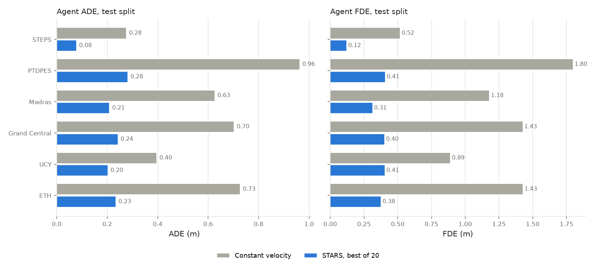
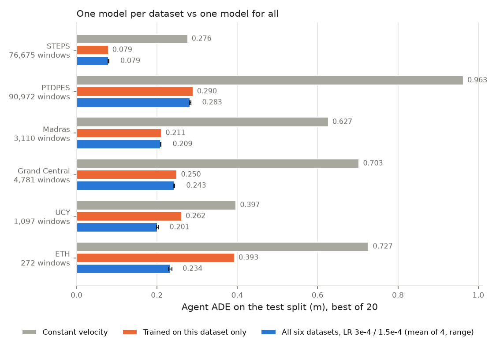
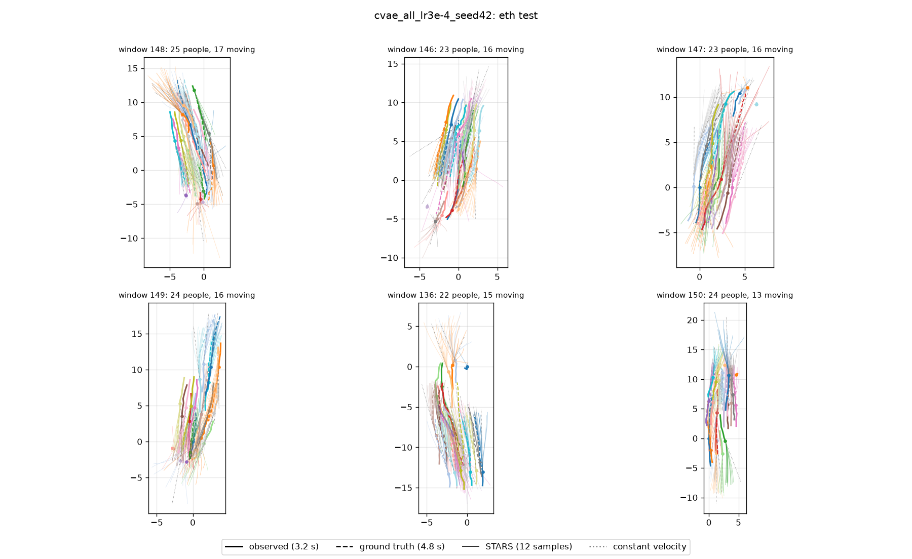
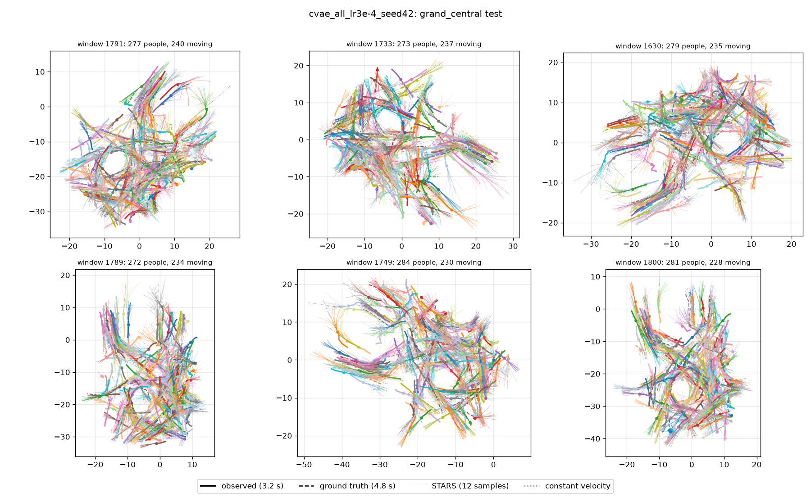
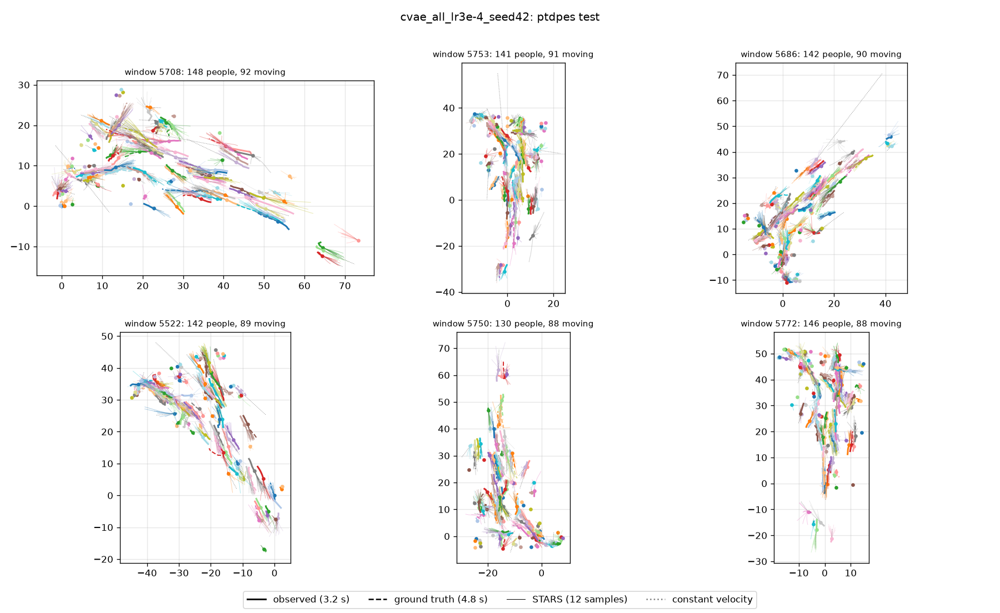
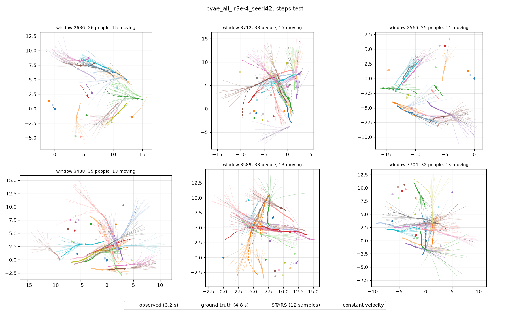

# Latest trajectory forecaster: Pooled six-dataset CVAE, LR 3e-4

Published 2026-10-22 from commit `f1183e3`. Regenerated by `python -m baselines.publish_latest_forecaster` for every new reference model; older versions live in git history.

Checkpoint: `experiments/stars_ma/runs/cvae_all_lr3e-4_seed42/checkpoints/best.pt` (best validation 0.2193 at epoch 41).

Reasoning: [`docs/decisions.md`](../decisions.md), entries 59, 84-86.

One model for STEPS, PTDPES, Madras, Grand Central, UCY and ETH. The SEAN-JAX crowd and planner still use the STEPS-only `cvae_kl01_finetune` (decision 86).

## Test results

Test split, best-of-20 for the CVAE, in metres. *Moving* = agents whose true future mean speed is above 0.2 m/s. *Rollout* = re-forecasting from its own predictions every 4 model steps.

| Dataset | Agent ADE / FDE | Moving ADE / FDE | Joint ADE | Constant velocity ADE / FDE | Rollout ADE |
| --- | --- | --- | --- | --- | --- |
| STEPS | 0.079 / 0.124 | 0.332 / 0.583 | 0.099 | 0.276 / 0.518 | 0.080 |
| PTDPES | 0.282 / 0.408 | 0.400 / 0.587 | 0.506 | 0.963 / 1.800 | 0.299 |
| Madras | 0.209 / 0.315 | 0.232 / 0.357 | 0.536 | 0.627 / 1.180 | 0.217 |
| Grand Central | 0.243 / 0.403 | 0.243 / 0.403 | 0.562 | 0.703 / 1.427 | 0.243 |
| UCY | 0.203 / 0.406 | 0.322 / 0.644 | 0.311 | 0.397 / 0.891 | 0.197 |
| ETH | 0.235 / 0.377 | 0.240 / 0.386 | 0.383 | 0.727 / 1.428 | 0.238 |



## Against one model per dataset



## Forecasts

Test windows with the most moving pedestrians. Thick: observed 3.2 s; dashed: ground truth 4.8 s; thin: STARS samples; dotted grey: constant velocity.

### ETH



### Grand Central



### PTDPES



### STEPS



## Recipe

```yaml
config: configs/stars_ma/all.yaml
decoder: cvae
cvae_latent_dim: 64
encoder_mode: scratch
knn: 24
radius: 10.0
kl_weight: 0.0799
learning_rate: 0.0003
weight_decay: 0.00217
dropout: 0.0905
decoder_dropout: 0.0633
decoder_hidden_dim: 512
warmup_epochs: 4.31
max_nodes: 4096
epochs: 60
seed: 42
```

Evaluate it:

```bash
python -m baselines.evaluate_stars_ma --checkpoint experiments/stars_ma/runs/cvae_all_lr3e-4_seed42/checkpoints/best.pt --config configs/stars_ma/all.yaml \
  --split test --device cuda --output eval_test_all.json
```
