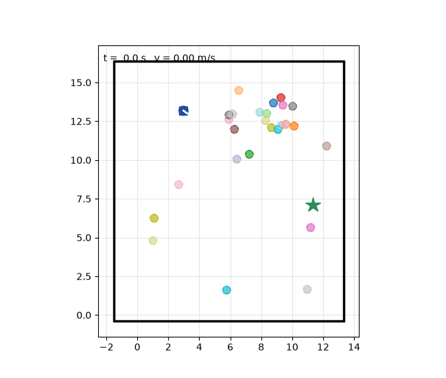
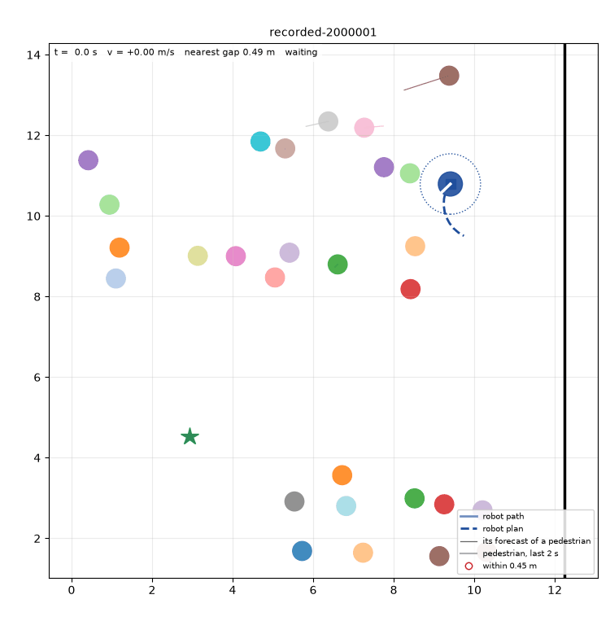
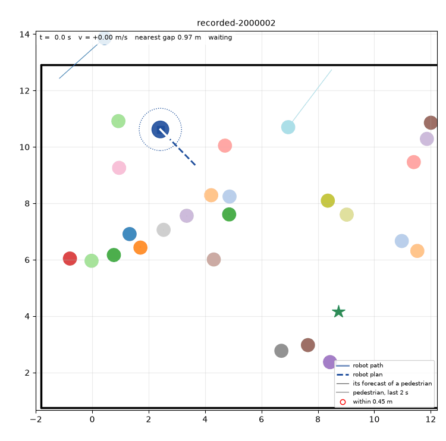
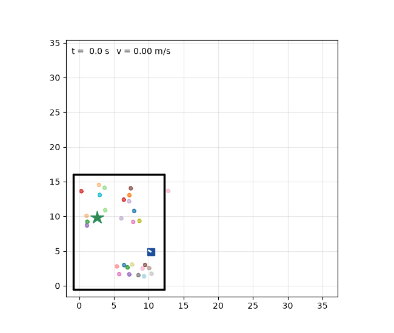
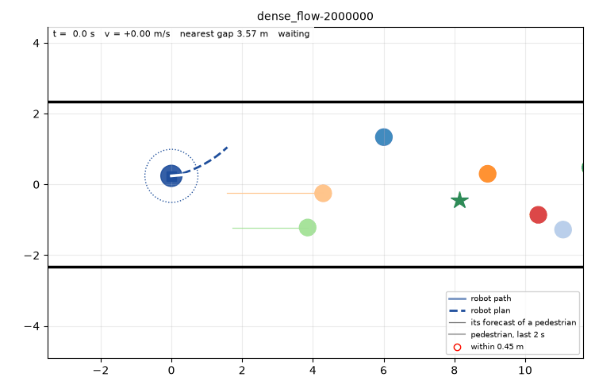
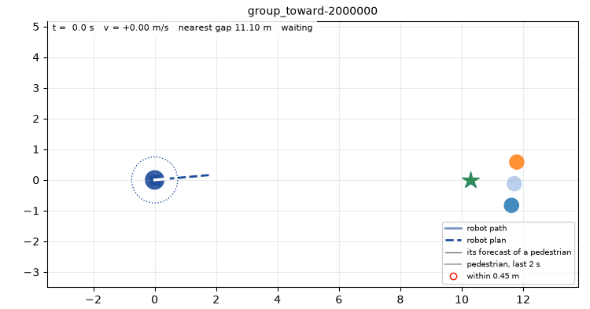
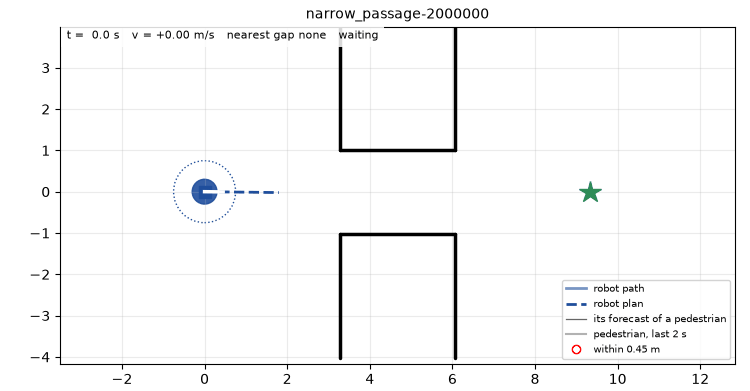
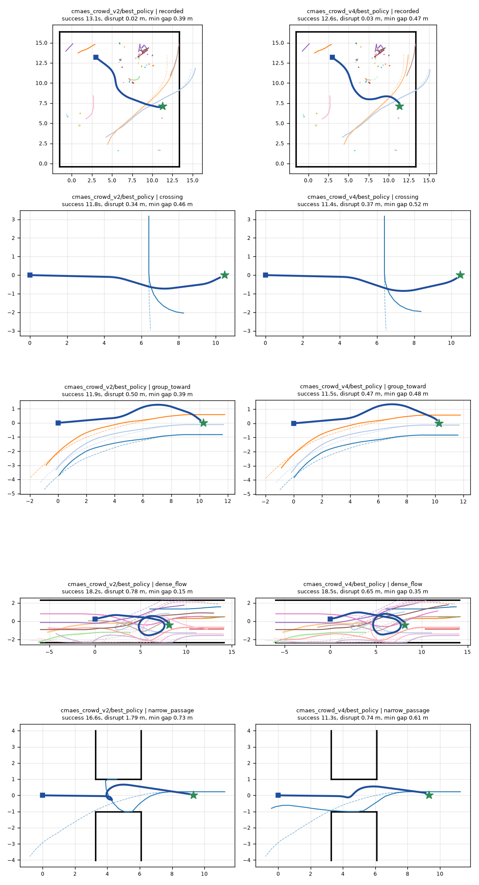
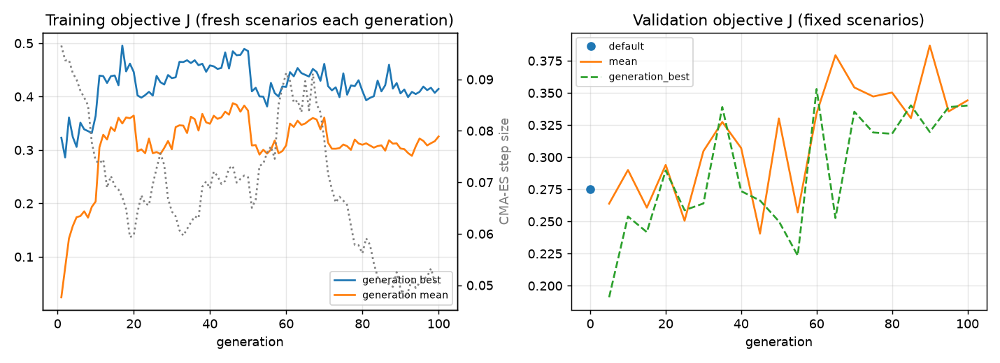

# Latest navigation policy: Crowd v4

Published 2026-10-22 from commit `3fb705e`. This folder is regenerated by `simplenavsim/scripts/publish_latest_policy.py` for every new reference policy; older versions live in git history.

Reasoning: [`docs/decisions.md`](../decisions.md), entries 70, 75, 77, 79, 83, 87.

**Robustness: a crowd it was not tuned in.** With the pooled six-dataset forecaster driving the crowd (decision 87), v4 keeps 97% success, 0.4% collisions, 2.2% intimate-zone time and 93% success on recorded scenes. That crowd reacts about 3x less to the robot, so its objective values are not comparable to the table below.

## Test results

270 test scenarios in the STARS-driven crowd (`cmaes_crowd_v4.yaml`); the objective is the one this policy was tuned on. `< 0.45 m` is the fraction of time a pedestrian is in the robot's intimate zone; loops are full turns beyond half a turn per episode.

| Policy | Objective | Success | Collision | < 0.45 m | Path eff. | Loops | Time (s) |
| --- | ---: | ---: | ---: | ---: | ---: | ---: | ---: |
| **Crowd v4** | 0.375 | 98% | 1.1% | 2.6% | 0.90 | 0.08 | 12.3 |
| goal_seeking (default) | -2.149 | 38% | 62.2% | 11.4% | 0.38 | 0.00 | 12.5 |
| social (default) | -0.196 | 83% | 7.8% | 16.4% | 0.82 | 0.01 | 12.9 |
| cmaes_crowd_v4_s7/best_policy | 0.367 | 99% | 0.4% | 5.2% | 0.91 | 0.11 | 12.4 |
| cmaes_crowd_v4_s3/best_policy | 0.340 | 98% | 1.1% | 3.0% | 0.89 | 0.12 | 12.7 |
| cmaes_crowd_v2/best_policy | 0.276 | 96% | 1.5% | 5.4% | 0.90 | 0.10 | 12.9 |
| cmaes/best_policy | 0.196 | 91% | 0.7% | 1.3% | 0.85 | 0.09 | 13.7 |

### By scenario

| Scenario | Objective | Success | Collision | < 0.45 m | Path eff. | Loops | Time (s) |
| --- | ---: | ---: | ---: | ---: | ---: | ---: | ---: |
| crossing | -0.164 | 100% | 0.0% | 2.2% | 0.91 | 0.13 | 12.3 |
| dense_flow | 0.424 | 93% | 3.3% | 5.6% | 0.87 | 0.16 | 12.1 |
| following | 0.474 | 100% | 0.0% | 0.4% | 0.99 | 0.03 | 10.9 |
| group_toward | 0.554 | 100% | 0.0% | 1.7% | 0.93 | 0.02 | 12.1 |
| head_on | 0.023 | 93% | 6.7% | 3.4% | 0.90 | 0.02 | 11.0 |
| narrow_passage | 0.391 | 100% | 0.0% | 2.7% | 0.95 | 0.14 | 12.8 |
| overtaking | 0.254 | 97% | 0.0% | 3.9% | 0.77 | 0.09 | 15.0 |
| recorded | 0.626 | 100% | 0.0% | 3.5% | 0.87 | 0.14 | 13.2 |
| stationary_group | 0.790 | 100% | 0.0% | 0.1% | 0.94 | 0.00 | 11.8 |

## Rollouts

The view follows the robot (blue disc, white tick = heading; square: start, star: goal). **Blue line**: where it has been. **Blue dashed**: the plan it just chose. **Thin coloured lines**: what it predicts each nearby pedestrian (within 4 m) will do; that forecast is what the plan is scored against. Pedestrians have fading 2 s trails and turn red-outlined inside the 0.45 m intimate zone (the dotted ring). The status line gives time, speed, the nearest gap and whether the robot is driving, waiting or stopping; the final frame states the outcome. Playback is about 1.8x real time. Single episodes show behaviour, not rates: the outcome of a close encounter can change between runs (decision 83).

### Recorded STEPS traffic (`recorded-2000000`)



### Recorded STEPS traffic (`recorded-2000001`)



### Recorded STEPS traffic (`recorded-2000002`)



### Recorded STEPS traffic (`recorded-2000003`)



### Dense cross flow in a corridor (`dense_flow-2000000`)



### Group walking toward the robot (`group_toward-2000000`)



### Narrow passage with an oncoming pedestrian (`narrow_passage-2000000`)



## Side by side with earlier policies



## Tuning convergence



## Use it

From the repository root:

```bash
python simplenavsim/scripts/evaluate.py --config simplenavsim/configs/cmaes_crowd_v4.yaml \
  --policy docs/latest_policy/policy.yaml --split test --device cuda
python simplenavsim/scripts/visualize_rollout.py --config simplenavsim/configs/cmaes_crowd_v4.yaml \
  --checkpoint docs/latest_policy/policy.yaml --scenario dense_flow --device cuda
```

`config.yaml` here is a copy for reference; it names its simulator, pedestrian and policy configs relative to `simplenavsim/configs/`, so run with the original path above.

Parameters:

```yaml
policy: social
parameters:
  goal_weight: 0.5
  collision_weight: 5.0
  pedestrian_weight: 27.421758858554014
  disruption_weight: 0.010000000000000004
  obstacle_weight: 1.0
  preferred_speed: 1.0
  personal_space_radius: 0.5493780988825642
  prediction_horizon: 2.270173492329846
  turn_penalty: 0.0
  smoothness_weight: 0.39332201766194214
  speed_scale: 4.999999999999998
  retreat_scale: 1.5940824241431577
  alignment_weight: 0.07455376456126203
validation_objective: 0.3868139088153839
generation: 90
source: mean
```
