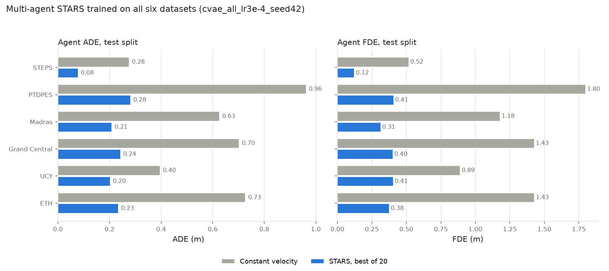
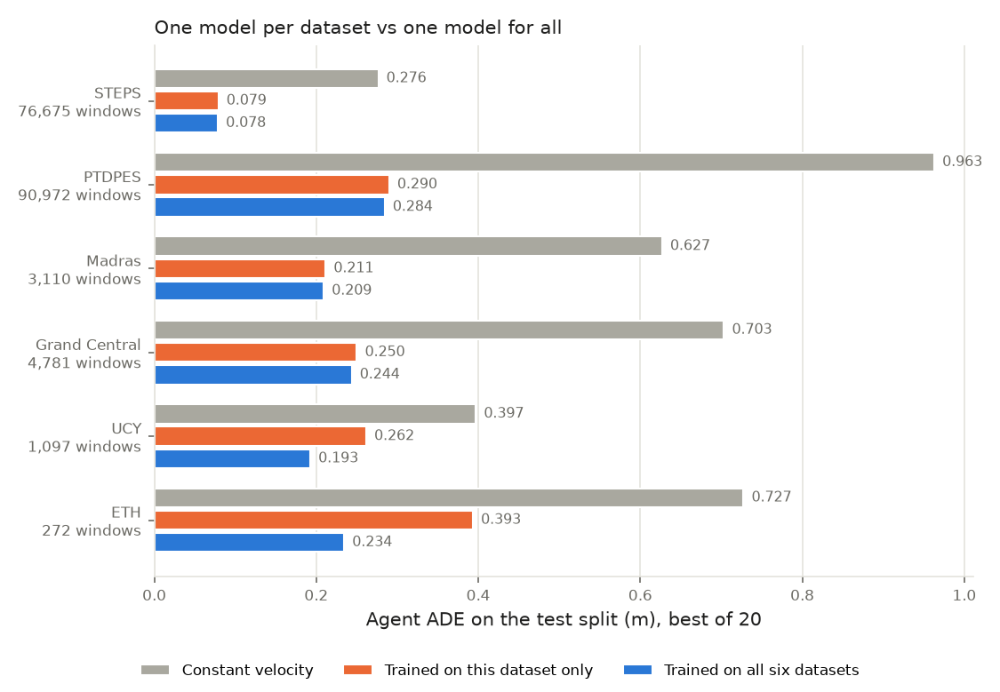

# Results overview

Living summary of the multi-agent STARS forecaster and the SEAN-JAX navigation experiments. The
numbers here are copied from the files linked below. The reasoning behind each choice is in
[`../decisions.md`](../decisions.md); entry numbers are given in brackets.

## Current references

| Use | Artifact | Headline (test split) |
| --- | --- | --- |
| STEPS forecaster, and the SEAN-JAX crowd and predictor | `experiments/stars_ma/runs/cvae_kl01_finetune/checkpoints/best.pt` | ADE / FDE 0.080 / 0.126 (constant velocity 0.276 / 0.518); realistic 20 s rollouts [48] |
| All-dataset forecaster | `experiments/stars_ma/runs/cvae_hpo53_scratch_all/checkpoints/best.pt` | 2-3.5x better than constant velocity on all six datasets. Seed-sensitive: this seed is the best of three, and averaged over seeds pooling beats per-dataset models only on UCY and ETH [80, 84] |
| Navigation policy | `checkpoints/seanjax/cmaes_crowd_v4/best_policy.yaml` | In the STARS crowd: 99% success, 0.7% collisions, 100% on recorded STEPS scenes [75] |

Closed questions: hyperparameter search has converged [61, 62]; closed-loop training does not
help [47, 65, 73]; controller cost terms cannot remove the remaining dense-flow loops [79].

## Trajectory forecasting (STEPS test split, 12,500 windows)

Scores are best-of-20 for the CVAE rows, in metres. *Moving* means agents whose true future mean
speed is above 0.2 m/s; about 90% of STEPS pedestrians are slower. The full table is
[`stars_ma_steps_test.md`](stars_ma_steps_test.md).

| Model | Agent ADE / FDE | Moving ADE / FDE | Joint ADE |
| --- | --- | --- | --- |
| Constant velocity | 0.276 / 0.518 | 0.894 / 1.771 | 0.279 |
| Deterministic decoder, fine-tuned phase-1 encoder | 0.115 / 0.205 | 0.559 / 1.107 | 0.119 |
| CVAE, KL 1.0, fine-tuned (collapsed latent, [32]) | 0.110 / 0.195 | 0.532 / 1.049 | — |
| **CVAE, KL 0.1, fine-tuned (`cvae_kl01_finetune`)** | **0.080 / 0.126** | **0.336 / 0.588** | **0.097** |
| CVAE, KL 0.1, from scratch with search settings | 0.081 / 0.129 | 0.342 / 0.600 | 0.097 |
| CVAE, best Optuna trial 53 at full length (2 seeds) | 0.079 / 0.125 | 0.333 / 0.587 | 0.097 |

- **KL weight is the key setting** [32–35, 41]. At 1.0 the latent collapsed: samples ended about
  9 mm apart. At about 0.1 the samples are diverse (0.16 m apart) and error falls 30–36%. Optuna
  attributes 51–58% of the variance in results to it; batch size accounts for 2–4%.
- **Seed noise** is about ±0.0007 m of validation ADE [44].
- **Pretraining helps a little** once the KL weight is right: fine-tuned beats from scratch,
  which beats frozen. Pretraining on all six datasets gives no extra gain on STEPS [46].
- **Most accurate vs most realistic** [48]: trial 53 is marginally more accurate, but its simulations are 25% too slow, so `cvae_kl01_finetune` drives the crowd and the planner.
- **Closed-loop (multi-step) training does not help** [47]. Rollouts are stable without it.
- **Simulation realism:** the best model's 20 s rollouts move at 0.115 m/s, matching smoothed real
  tracks. They are smoother than reality: acceleration is 0.03 vs 0.12 m/s² [38–39].
- **Figures:**
  - [`forecasts_cvae_frozen.png`](forecasts_cvae_frozen.png): KL 1.0, nearly identical samples.
  - [`forecasts_cvae_hpo0_scratch_full.png`](forecasts_cvae_hpo0_scratch_full.png): KL ≈ 0.1,
    diverse samples.
- **Searches:** [`hpo_steps_cvae_scratch.md`](hpo_steps_cvae_scratch.md) and
  [`hpo_steps_cvae_ssl.md`](hpo_steps_cvae_ssl.md).

### All six datasets (test split) [59]

Full table: [`stars_ma_all_test.md`](stars_ma_all_test.md). From-scratch model with trial-53
settings, agent ADE / FDE, best-of-20, against constant velocity:

| Dataset | Constant velocity | STARS (`cvae_hpo53_scratch_all`) |
| --- | --- | --- |
| STEPS | 0.276 / 0.518 | 0.078 / 0.123 |
| PTDPES | 0.963 / 1.800 | 0.284 / 0.413 |
| Madras | 0.627 / 1.180 | 0.209 / 0.315 |
| Grand Central | 0.703 / 1.427 | 0.244 / 0.403 |
| UCY | 0.397 / 0.891 | 0.193 / 0.383 |
| ETH | 0.727 / 1.428 | 0.234 / 0.373 |

- SSL pretraining plus fine-tuning is 0.002–0.010 m worse on every dataset.
- **One model per dataset vs one for all** [80, 84]: seed 42 of the all-dataset model (charted) is
  better than or level with each dataset's own model everywhere. Over three seeds, though, the
  all-dataset model averages 2-6% *worse* on STEPS, PTDPES, Madras and Grand Central, and 18-35%
  better on UCY and ETH. A 60-epoch schedule is being tested to remove the seed sensitivity.

- Feeding back its own predictions every step costs little on STEPS but 14–20% elsewhere.

## Navigation (SEAN-JAX lightweight backend, 80 scripted test scenarios)

Objective v1 = success − 2·collision − disruption − 0.3·time − 0.5·personal-zone rate.

**Same parameters, different pedestrian predictor** [37]:

| Policy | Constant velocity | STARS forecaster |
| --- | --- | --- |
| Goal-seeking baseline | −0.572 (30% collisions) | — |
| Social controller, default | 0.439 (2.5% collisions) | 0.536 (0 collisions) |
| CMA-ES tuned v1 (`checkpoints/seanjax/cmaes/best_policy.yaml`) | 0.612 | **0.647** |

**Robustness to the pedestrian model:** the v1 policy, tuned against reactive replay, has 0
collisions and beats the default under ORCA, social force and replay pedestrians [29].

**Controller fixes**, prompted by the rollout figures:
- [43] Tuned policies orbited instead of waiting. A retreat penalty, a speed cost that fades near
  pedestrians and slow reversing fixed this. Results above this point used the old controller.
- [45] A warm-started policy scored 0.707 by circling pedestrians and driving around walls. This is
  reward hacking. Objective v2 adds detour (path efficiency) and smoothness terms; reruns are in
  progress.

**Objective v2** adds detour (1 − path efficiency) and command smoothness terms [50]. Scripted
test, best STARS predictor:

| Policy | Objective v2 | Success | Path efficiency | Disruption (m) | Time (s) |
| --- | --- | --- | --- | --- | --- |
| Default social | 0.425 | 100% | 0.98 | 0.206 | 13.6 |
| v1 (cautious) | 0.354 | 91% | 0.85 | 0.067 | 13.5 |
| **Warm start v2** (`cmaes_stars_best_warm_v2`) | **0.449** | 96% | 0.91 | 0.115 | 12.4 |

**Figures:**
- [`navigation_compare_warm_v2.png`](navigation_compare_warm_v2.png): default vs v1 vs warm start
  v2, six scenarios.
- [`navigation_compare_stars.png`](navigation_compare_stars.png): goal-seeking vs default vs tuned,
  five scenarios.
- [`navigation_compare_warm.png`](navigation_compare_warm.png): the reward-hacking policy.
- Per-run GIFs are under `runs/seanjax/*/visualize/` (not in git).

## Forecaster as the crowd

`stars_crowd` moves the simulated pedestrians with the forecaster itself, with the robot as one
more person in the graph [46].
- Intents follow an AR(1) process, and recorded goals keep 1 m from pedestrians [55].
- Pedestrians cannot walk through walls [64].
- The comfort term counts time within 0.45 m of a pedestrian [58].

Results on 270 test scenarios (30 per kind, including 30 recorded STEPS scenes). The objective
charges 0.2 per extra loop, and the tuner also sets the controller's waiting costs [70, 75]:

| Policy | Objective | Success | Collision | Time within 0.45 m | Loops / episode | Recorded success |
| --- | --- | --- | --- | --- | --- | --- |
| Goal-seeking | -2.149 | 38% | 62% | 11.4% | 0.00 | 27% |
| Default social | -0.196 | 83% | 7.8% | 16.4% | 0.01 | 77% |
| v1 (tuned against reactive replay) | 0.196 | 91% | 0.7% | 1.3% | 0.09 | 67% |
| Tuned in the crowd, v2 | 0.276 | 96% | 1.5% | 5.4% | 0.10 | 87% |
| Tuned in the crowd, v3 (wall-respecting crowd) | 0.321 | 97% | 0.4% | 1.4% | 0.19 | 77% |
| **Tuned in the crowd, v4** (`cmaes_crowd_v4`) | **0.388** | **99%** | 0.7% | 2.6% | **0.08** | **100%** |

Evaluation noise is about ±0.02 [72].

Figures:
- [`navigation_compare_crowd_v6.png`](navigation_compare_crowd_v6.png): v2 against v4. The loop in
  the narrow passage is gone; dense flow still loops.
- [`navigation_compare_crowd_v4.png`](navigation_compare_crowd_v4.png): v1, the first crowd run
  and v2 in the wall-respecting crowd.
