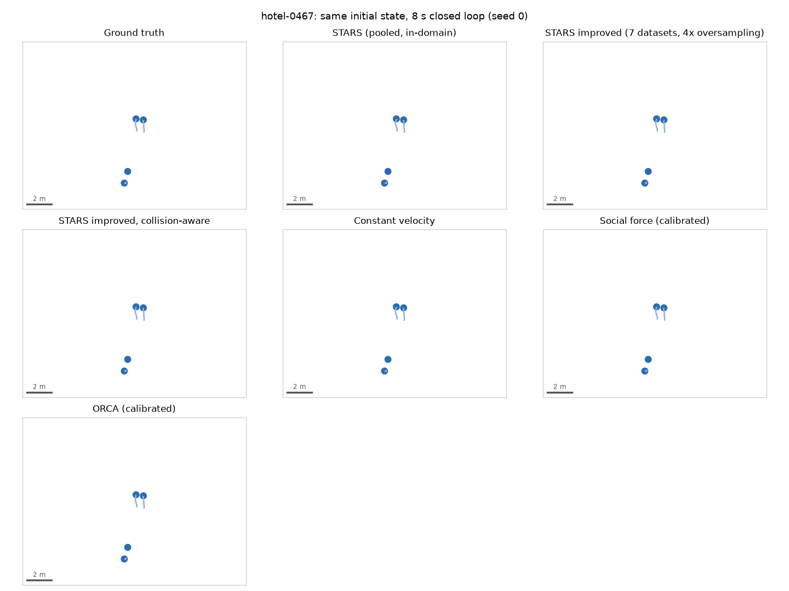
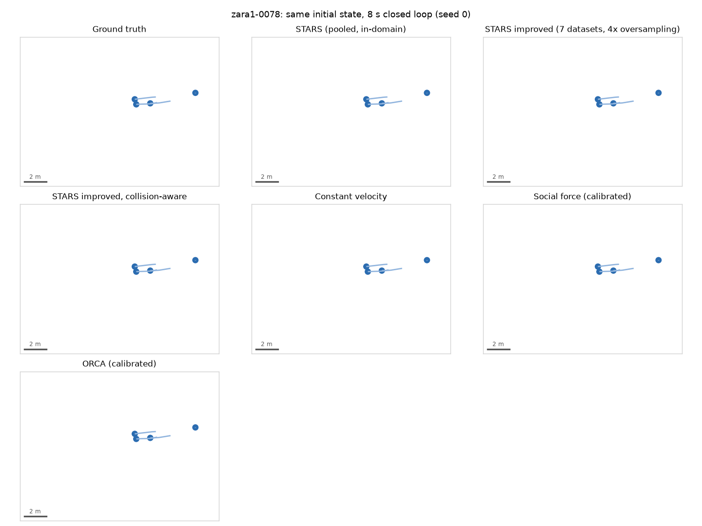
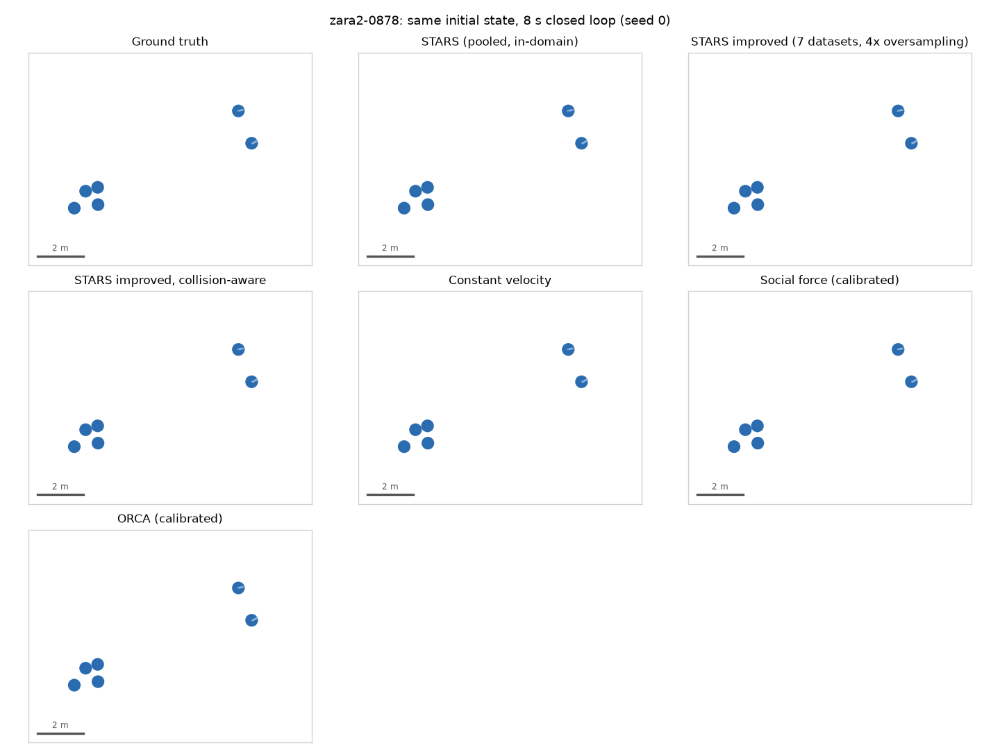

# Closed-loop examples on ETH/UCY (2026-11-16)

Same initial state, 8 s closed loop (every model re-forecasts every 0.4 s from its own previous
steps), seed 0. Panels: the real recording, the previous pooled STARS, **STARS improved** (all 7
datasets; 4 rollouts per scene, the one with the fewest close pairs kept), **STARS collision-aware**
(refinement round + collision loss, KL 0.15), constant velocity, social force and ORCA (both
calibrated on held-out UCY recordings). One scene per ETH/UCY dataset, chosen at random (seeded).
All 10 scenarios and the preference-study clips: `results/ethucy_2026-11-16_improved/` (media is
git-ignored; regenerate with the command below).

| Closed loop, all ETH/UCY windows | ADE 4.8 s | ADE 8 s | ADE 12 s | Colliding pair-steps (< 0.4 m) at 8 s |
| --- | --- | --- | --- | --- |
| Real pedestrians | | | | 0.48% |
| Constant velocity | 0.50 | 0.91 | 1.43 | 0.75% |
| Social force (calibrated) | 0.57 | 0.97 | 1.35 | 0.08% |
| ORCA (calibrated) | 0.56 | **0.90** | **1.24** | 0.01% |
| STARS (previous, 6 datasets) | 0.54 | 0.99 | 1.51 | 0.77% |
| STARS improved | 0.52 | 0.99 | 1.57 | 0.67% |
| STARS collision-aware | 0.58 | 1.04 | 1.62 | 0.03% |

One rollout (seed 0) per model. STARS improved collides a little less than before; the
collision-aware variant collides less than real people do (as SFM and ORCA do). In this closed
loop the hand-made models stay competitive on ADE beyond 8 s; in open-loop forecasting STARS is
far more accurate (`docs/results/forecasting_benchmark/` on branch `forecast-benchmark`).
STARS models saw hotel, univ and zara1 in training.

Eth (seq_eth)


Hotel



Univ (students001)


Zara1



Zara2



Regenerate (closed loop on CPU took about 2 h for both new models):

```bash
python simplenavsim/scripts/ethucy_benchmark.py run --run results/ethucy_2026-11-16_improved --append \
    --methods stars_improved stars_improved_social --seeds 1
python simplenavsim/scripts/ethucy_benchmark.py render --run results/ethucy_2026-11-16_improved
```
