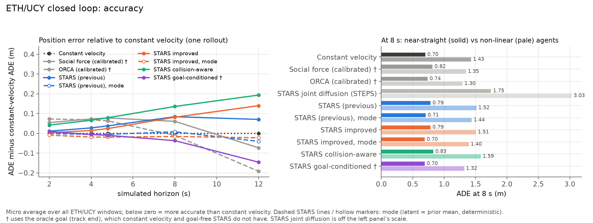
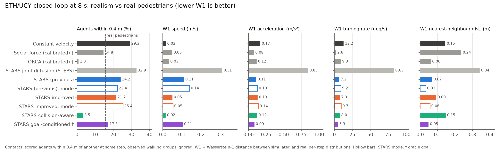
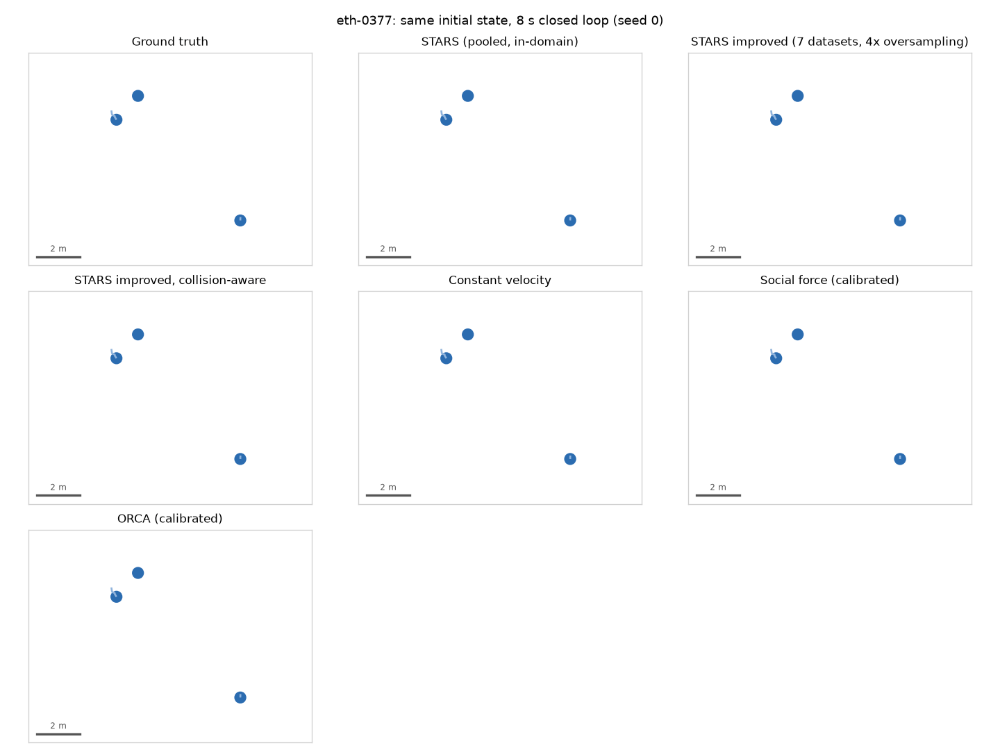
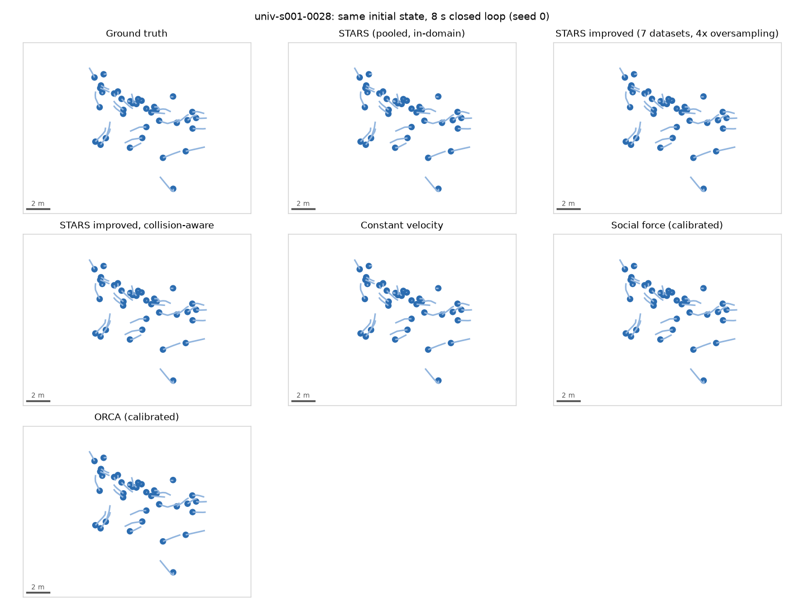

# Closed-loop examples on ETH/UCY (2026-11-16, metrics updated 2026-11-18)

Same initial state, 8 s closed loop (every model re-forecasts every 0.4 s from its own previous
steps), seed 0. Panels: the real recording, the previous pooled STARS, **STARS improved** (all 7
datasets; 4 rollouts per scene, the one with the fewest close pairs kept), **STARS collision-aware**
(refinement round + collision loss, KL 0.15), constant velocity, social force and ORCA (both
calibrated on held-out UCY recordings). One scene per ETH/UCY dataset, chosen at random (seeded).
All 10 scenarios and the preference-study clips: `results/ethucy_2026-11-16_improved/` (media is
git-ignored; regenerate with the command below).



| Closed loop, all ETH/UCY windows | ADE 4.8 s | ADE 8 s | ADE 12 s | Agents in contact at 8 s, < 0.2 / < 0.4 m | Colliding pair-steps at 8 s |
| --- | --- | --- | --- | --- | --- |
| Real pedestrians | | | | 1.2% / 15.6% | 0.48% |
| Constant velocity | 0.50 | 0.91 | 1.43 | 14.6% / 29.3% | 0.75% |
| STARS (previous, 6 datasets) | 0.53 | 0.99 | 1.50 | 11.9% / 24.2% | 0.82% |
| &nbsp;&nbsp;mode | 0.49 | 0.92 | **1.39** | 11.3% / 22.4% | 0.87% |
| STARS improved | 0.52 | 0.99 | 1.57 | 8.2% / 21.7% | 0.67% |
| &nbsp;&nbsp;**mode** | **0.48** | **0.89** | 1.40 | 11.4% / 25.4% | 0.78% |
| STARS collision-aware | 0.58 | 1.04 | 1.62 | 0.1% / 3.5% | 0.03% |
| &nbsp;&nbsp;mode | 0.54 | 0.98 | 1.53 | 0.3% / 5.4% | 0.07% |
| STARS, no ETH/UCY (zero-shot) | 0.56 | 1.03 | 1.63 | 7.7% / 21.2% | 0.55% |
| &nbsp;&nbsp;mode | 0.51 | 0.96 | 1.53 | 7.4% / 20.3% | 0.55% |
| STARS diffusion, per agent (STEPS only, zero-shot) | 1.38 | 2.48 | 4.01 | 15.9% / 37.5% | 0.72% |
| STARS diffusion, joint (STEPS only, zero-shot) | 1.26 | 2.11 | 2.98 | 14.6% / 32.9% | 0.79% |
| *uses the oracle goal (privileged)* | | | | | |
| *STARS goal-conditioned, no ETH/UCY †* | *0.49* | *0.87* | *1.28* | 6.0% / 17.3% | 0.64% |
| *Social force (calibrated) †* | *0.57* | *0.97* | *1.35* | 1.1% / 14.8% | 0.08% |
| *ORCA (calibrated) †* | *0.56* | *0.90* | *1.24* | 0.0% / 1.0% | 0.01% |

* **mode** = STARS with the latent set to its prior mean (z = μ, no sampling). It gives one deterministic rollout,
  the fair comparison to constant velocity. The other STARS rows sample a latent: STARS (previous) and no-ETH/UCY
  average 5 rollouts; improved, collision-aware and diffusion use one.
* **Deterministic STARS improved beats CV at every horizon.** The paired block-bootstrap difference is significant
  up to 4.8 s (−0.019 m, CI [−0.030, −0.008]), but not at 8 s (−0.016, CI [−0.040, 0.010]) or 12 s (−0.023, CI
  [−0.084, 0.046]).
* **Sampled STARS loses to CV** (+0.08 m at 8 s). The random sample's spread compounds in the loop.
* **Contacts**: agents that come within 0.2 / 0.4 m of another scored agent, ignoring pairs that already walk
  together in the observation (within 1 m, velocities within 0.3 m/s).
* **†** = reads each agent's oracle goal (its track's last recorded position). Constant velocity and the goal-free
  STARS rows do not have this information, so † rows are not a like-for-like comparison.
* The STARS pooled / improved / collision-aware models saw hotel, univ and zara1 in training.



**Realism at 8 s** (Wasserstein-1 distance from the real per-step distributions):

| Measure | Closest | Constant velocity | Farthest |
| --- | --- | --- | --- |
| Agents in contact (< 0.4 m) | social force (14.8% vs 15.6% real) | 29% | ORCA (1%, too few contacts) |
| Speed | CV and STARS collision-aware (0.02 m/s) | 0.02 m/s | STARS diffusion (0.31-0.54) |
| Acceleration | social force (0.08 m/s²) | 0.17 m/s² | STARS diffusion (0.85-0.97) |
| Turning rate | social force (2.6 deg/s) | 13.2 deg/s | STARS diffusion (62-83) |
| Nearest-neighbour distance | STARS (previous) mode (0.03 m) | 0.15 m | social force (0.24 m) |

* Learned STARS is in between on acceleration (0.09-0.14 m/s²) and turning (5-10 deg/s).
* STARS sits between CV (29%) and the data on contacts: 21-25% for the main models. The collision-aware model has
  3.5%, fewer than real people.
* **STARS diffusion in closed loop is poor**: ADE 2.1-2.5 m at 8 s, and turning-rate W1 of 60-80 deg/s. Each
  re-forecast's first step is noisy (0.12 m error after 0.4 s vs 0.03 m for the CVAE), and the loop compounds that
  noise.
* Full tables (all horizons, CIs, near-straight vs non-linear ADE, paired tests):
  `results/ethucy_2026-11-16_improved/report.md`.

Eth (seq_eth)



Hotel


Univ (students001)



Zara1


Zara2


Regenerate (closed loop on CPU took about 2 h for both new models; on one GPU each STARS rollout takes 10-130 s):

```bash
python simplenavsim/scripts/ethucy_benchmark.py run --run results/ethucy_2026-11-16_improved --append \
    --methods stars_improved stars_improved_social --seeds 1
python simplenavsim/scripts/ethucy_benchmark.py render --run results/ethucy_2026-11-16_improved
# mode, diffusion and no-ETH/UCY rows (GPU), then rescore every saved rollout with the realism metrics:
python simplenavsim/scripts/ethucy_benchmark.py run --run results/ethucy_2026-11-16_improved --append --device cuda --seeds 1 \
    --methods stars_pooled_mode stars_noethucy_mode stars_improved_mode stars_improved_social_mode \
              stars_steps_diffusion stars_steps_joint_diffusion
python simplenavsim/scripts/ethucy_benchmark.py run --run results/ethucy_2026-11-16_improved --append --device cuda --seeds 5 \
    --methods stars_noethucy stars_noethucy_goal
python simplenavsim/scripts/ethucy_benchmark.py run --run results/ethucy_2026-11-16_improved --reuse --methods <all saved methods>
python simplenavsim/scripts/ethucy_benchmark.py aggregate|plot|report --run results/ethucy_2026-11-16_improved
python results/ethucy_2026-11-16_improved/figures/make_summary.py
```
(In practice each GPU wrote to its own run directory and the trajectories were copied in before `--reuse`.)
