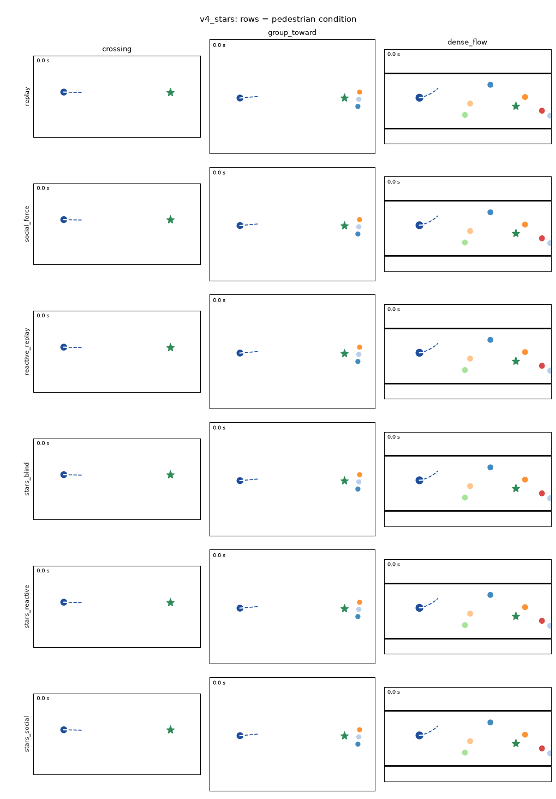

# Pedestrian conditions × policies (decision 96)

Made by `simplenavsim/scripts/crowd_conditions.py` (job 71961). GIF grids: rows are pedestrian
conditions, columns are the three fixed test scenes. [v4 + STARS predictor](grid_v4_stars.gif),
[v4 + constant-velocity predictor](grid_v4_cv.gif).

Scenes: crossing, group_toward, dense_flow (test split). Means over all scenes; the fixed-scene outcomes are those in the GIF grids.

| Condition | Policy | success | collision | intimate_violation_rate | min_ped_clearance | time_efficiency | path_efficiency | loops | disruption_local |
| --- | --- | --- | --- | --- | --- | --- | --- | --- | --- |
| replay | goal_seeking | 0.311 | 0.689 | 0.068 | 0.150 | 0.249 | 0.311 | 0.000 | 0.000 |
| replay | social_default | 0.911 | 0.089 | 0.086 | 0.230 | 0.714 | 0.897 | 0.011 | 0.000 |
| replay | v4_cv | 0.989 | 0.011 | 0.019 | 0.523 | 0.834 | 0.908 | 0.103 | 0.000 |
| replay | v4_stars | 1.000 | 0.000 | 0.020 | 0.522 | 0.835 | 0.912 | 0.138 | 0.000 |
| social_force | goal_seeking | 0.667 | 0.333 | 0.076 | 0.362 | 0.533 | 0.667 | 0.000 | 0.542 |
| social_force | social_default | 1.000 | 0.000 | 0.064 | 0.466 | 0.784 | 0.991 | 0.012 | 0.326 |
| social_force | v4_cv | 0.989 | 0.000 | 0.008 | 0.694 | 0.810 | 0.888 | 0.167 | 0.272 |
| social_force | v4_stars | 0.989 | 0.000 | 0.010 | 0.696 | 0.810 | 0.883 | 0.206 | 0.257 |
| reactive_replay | goal_seeking | 0.589 | 0.411 | 0.073 | 0.256 | 0.470 | 0.589 | 0.000 | 0.382 |
| reactive_replay | social_default | 0.989 | 0.011 | 0.065 | 0.391 | 0.748 | 0.963 | 0.072 | 0.205 |
| reactive_replay | v4_cv | 0.978 | 0.000 | 0.012 | 0.611 | 0.806 | 0.881 | 0.201 | 0.133 |
| reactive_replay | v4_stars | 0.989 | 0.000 | 0.008 | 0.639 | 0.818 | 0.896 | 0.160 | 0.126 |
| stars_blind | goal_seeking | 0.367 | 0.633 | 0.068 | 0.170 | 0.292 | 0.367 | 0.000 | 0.511 |
| stars_blind | social_default | 0.956 | 0.044 | 0.079 | 0.250 | 0.746 | 0.941 | 0.007 | 0.023 |
| stars_blind | v4_cv | 0.989 | 0.000 | 0.021 | 0.529 | 0.834 | 0.909 | 0.117 | 0.022 |
| stars_blind | v4_stars | 0.989 | 0.011 | 0.023 | 0.527 | 0.829 | 0.906 | 0.120 | 0.018 |
| stars_reactive | goal_seeking | 0.378 | 0.622 | 0.071 | 0.173 | 0.302 | 0.378 | 0.000 | 1.086 |
| stars_reactive | social_default | 0.911 | 0.089 | 0.097 | 0.244 | 0.703 | 0.888 | 0.041 | 0.578 |
| stars_reactive | v4_cv | 0.989 | 0.000 | 0.029 | 0.521 | 0.823 | 0.901 | 0.128 | 0.450 |
| stars_reactive | v4_stars | 0.978 | 0.011 | 0.028 | 0.542 | 0.820 | 0.895 | 0.112 | 0.461 |
| stars_social | goal_seeking | 0.522 | 0.478 | 0.066 | 0.263 | 0.417 | 0.522 | 0.000 | 1.036 |
| stars_social | social_default | 0.989 | 0.011 | 0.062 | 0.367 | 0.770 | 0.981 | 0.011 | 0.624 |
| stars_social | v4_cv | 1.000 | 0.000 | 0.012 | 0.616 | 0.818 | 0.898 | 0.159 | 0.467 |
| stars_social | v4_stars | 1.000 | 0.000 | 0.010 | 0.634 | 0.819 | 0.895 | 0.150 | 0.422 |

## Fixed scenes (v4 + STARS predictor)

| Condition | crossing-2000000 | group_toward-2000000 | dense_flow-2000000 |
| --- | --- | --- | --- |
| replay | reached 11.4 s, gap 0.52 m | reached 11.9 s, gap 0.41 m | reached 20.1 s, gap 0.23 m |
| social_force | reached 11.2 s, gap 0.71 m | reached 13.5 s, gap 0.67 m | reached 9.3 s, gap 0.33 m |
| reactive_replay | reached 11.3 s, gap 0.72 m | reached 12.4 s, gap 0.46 m | reached 21.6 s, gap 0.11 m |
| stars_blind | reached 11.4 s, gap 0.51 m | reached 11.9 s, gap 0.45 m | reached 21.0 s, gap 0.06 m |
| stars_reactive | reached 11.5 s, gap 0.13 m | reached 12.2 s, gap 0.44 m | COLLISION, gap -0.00 m |
| stars_social | reached 11.4 s, gap 0.77 m | reached 13.1 s, gap 0.30 m | reached 16.6 s, gap 0.39 m |

## Crowd realism (recorded STEPS test scenes, robot absent)

| Condition | position_error | error_at_5s | error_at_10s | speed_sim | speed_real | overlap_rate |
| --- | --- | --- | --- | --- | --- | --- |
| replay | 0.000 | 0.000 | 0.000 | 0.158 | 0.158 | 0.011 |
| social_force | 0.429 | 0.656 | 0.657 | 0.177 | 0.160 | 0.001 |
| reactive_replay | 0.320 | 0.368 | 0.429 | 0.177 | 0.158 | 0.001 |
| stars_blind | 0.362 | 0.189 | 0.561 | 0.084 | 0.158 | 0.010 |
| stars_reactive | 0.364 | 0.188 | 0.551 | 0.084 | 0.158 | 0.010 |
| stars_social | 0.848 | 0.578 | 1.039 | 0.103 | 0.158 | 0.000 |
