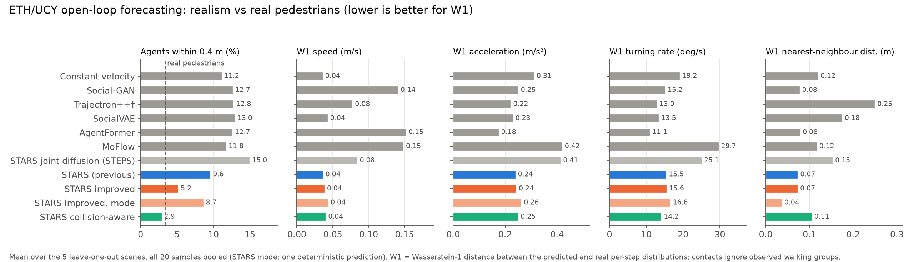

# Forecasting benchmark (2026-11-16)

Open-loop trajectory forecasting (observe 3.2 s, predict 4.8 s, dt 0.4 s) on the standard ETH/UCY
leave-one-out protocol and on each of our datasets' test splits, plus a closed loop up to 20 s.
Full report, tables and commands: [`results/forecasting_2026-11-16_89f5e72/report.md`](../../../results/forecasting_2026-11-16_89f5e72/report.md).
Figures: `python results/forecasting_2026-11-16_89f5e72/figures/make_summary.py`.

| ETH/UCY (mean of 5 scenes) | Best of 20, per agent ADE / FDE | Best of 20, scene ADE / FDE | Single sample ADE / FDE | Single-sample ADE straight / non-linear | Contacts < 0.2 / < 0.4 m | Samples drawn |
| --- | --- | --- | --- | --- | --- | --- |
| Real pedestrians | | | | | 0.2% / 3.3% | |
| Constant velocity | 0.53 / 1.15 | 0.54 / 1.15 | 0.53 / 1.15 | 0.48 / 0.93 | 4.5% / 11.2% | deterministic |
| Social-GAN | 0.36 / 0.64 | 0.48 / 0.92 | 0.86 / 1.79 | 0.83 / 1.19 | 5.5% / 12.7% | one noise vector per scene |
| Trajectron++ (observed-step inputs) | 0.34 / 0.61 | 0.46 / 0.90 | 0.73 / 1.58 | 0.70 / 1.10 | 5.5% / 12.8% | independent per agent |
| SocialVAE | 0.25 / 0.44 | 0.38 / 0.76 | 0.66 / 1.42 | 0.61 / 1.05 | 5.4% / 13.0% | independent per agent |
| AgentFormer | 0.23 / 0.39 | 0.38 / 0.75 | 1.05 / 2.34 | 1.00 / 1.39 | 5.5% / 12.7% | joint per scene (DLow) |
| MoFlow | **0.22 / 0.34** | 0.39 / 0.72 | 0.99 / 2.09 | 0.95 / 1.22 | 4.9% / 11.8% | each agent alone |
| STARS joint diffusion (STEPS only, zero-shot) | 0.30 / 0.49 | 0.43 / 0.78 | 0.82 / 1.67 | 0.77 / 1.25 | 6.0% / 15.0% | joint denoiser |
| STARS, no ETH/UCY in training (zero-shot) | 0.25 / 0.47 | 0.34 / 0.67 | 0.56 / 1.18 | 0.52 / 0.91 | 3.9% / 9.9% | latent per agent, joint decoder |
| &nbsp;&nbsp;mode | | | 0.46 / 0.96 | 0.42 / 0.80 | 2.9% / 8.2% | deterministic |
| STARS (previous, 6 datasets)* | 0.23 / 0.43 | 0.32 / 0.64 | 0.56 / 1.17 | 0.52 / 0.92 | 3.8% / 9.6% | latent per agent, joint decoder |
| &nbsp;&nbsp;mode | | | 0.44 / 0.94 | 0.40 / 0.79 | 3.1% / 7.7% | deterministic |
| **STARS improved** (7 datasets, 4x oversampling)* | 0.23 / 0.43 | **0.32 / 0.63** | 0.55 / 1.15 | 0.51 / 0.91 | 2.0% / 5.2% | as previous + least-colliding scene selection |
| &nbsp;&nbsp;**mode** | | | **0.44 / 0.92** | **0.39 / 0.79** | 3.1% / 8.7% | deterministic |
| **STARS collision-aware*** | 0.27 / 0.51 | 0.35 / 0.70 | 0.57 / 1.17 | 0.51 / 1.00 | **0.6% / 2.9%** | + refinement over neighbours' predicted futures |
| &nbsp;&nbsp;mode | | | 0.49 / 1.02 | 0.44 / 0.88 | 0.9% / 3.3% | deterministic |
| *STARS + oracle goal † (no ETH/UCY)* | *0.22 / 0.34* | *0.28 / 0.48* | *0.42 / 0.77* | *0.40 / 0.65* | 4.1% / 11.3% | privileged input |

* **Best of 20, per agent** (minADE): every agent picks its own best sample. **Best of 20, scene**
  (minJointADE): one sample index for all agents of a window.
* **Single sample**: the error of one draw, averaged over the 20 draws. **mode**: STARS with the latent set to its
  prior mean (z = μ, no sampling). This gives one deterministic forecast, the fair comparison to constant velocity.
* **Straight / non-linear**: the real future stays within, or departs by more than, 0.2 m on average from its
  start-end chord. 89% of ETH/UCY agents are straight, which is why CV is hard to beat with a random sample.
* **Contacts**: share of agents predicted within 0.2 / 0.4 m of another predicted agent. Pairs that already walk
  together in the observation are ignored (within 1 m, velocities within 0.3 m/s at the last observed step).
* **Samples drawn**: checked in each model's code as our adapters call it (details: report, Protocol).
* \* trained on hotel, univ and zara1: those scenes are leaked; eth and zara2 are clean. † reads each agent's
  track end, which no other row has.
* Baselines are the official pretrained checkpoints, reproduced against their papers. Trajectron++'s published
  numbers rely on velocity features computed from future positions; with observed steps only it scores about twice
  as badly.

**STARS mode beats constant velocity on single-sample accuracy**: 0.44 / 0.92 m vs 0.53 / 1.15 m (STARS
improved). It is better on both straight agents (0.39 vs 0.48) and non-linear agents (0.79 vs 0.93). A *random*
STARS sample (0.55) is slightly worse than CV because it adds spread. That spread is what earns the best-of-20
score.

**Realism** (Wasserstein-1 distance between predicted and real per-step distributions, all samples pooled; full
tables in the report):
* STARS is closest to the real speed distribution (W1 0.04 m/s, tied with CV and SocialVAE).
* STARS is closest to the real nearest-neighbour distance distribution (0.07 m, mode 0.04; AgentFormer and
  Social-GAN 0.08, CV 0.12).
* On acceleration and turning rate, AgentFormer, Trajectron++ and SocialVAE are closer (0.18-0.23 m/s², 11-14
  deg/s) than STARS (0.24, 15-16). CV (0.31, 19) and MoFlow and the diffusion decoders (0.41-0.42, 25-30) are the
  furthest.
* The STEPS-trained diffusion decoders are the least realistic STARS variants.

In the closed loop (each model's predictions fed back in), STARS has the lowest error of the learned
models at every horizon and keeps contacts near the real rate; the baselines drift to 46-72% of
agents in contact at 20 s. In the closed-loop ETH/UCY realism benchmark (branch `stars-improve`, `docs/results/closed_loop_examples/`), deterministic STARS improved (mode) also beats CV at every horizon: ADE 0.48 / 0.89 / 1.40 m at 4.8 / 8 / 12 s vs 0.50 / 0.91 / 1.43. The difference is significant up to 4.8 s. The STEPS-trained diffusion decoders do poorly there (2.1-2.5 m at 8 s). How STARS was improved: branch `stars-improve`,
`results/stars_improve_2026-11-15/README.md`.
