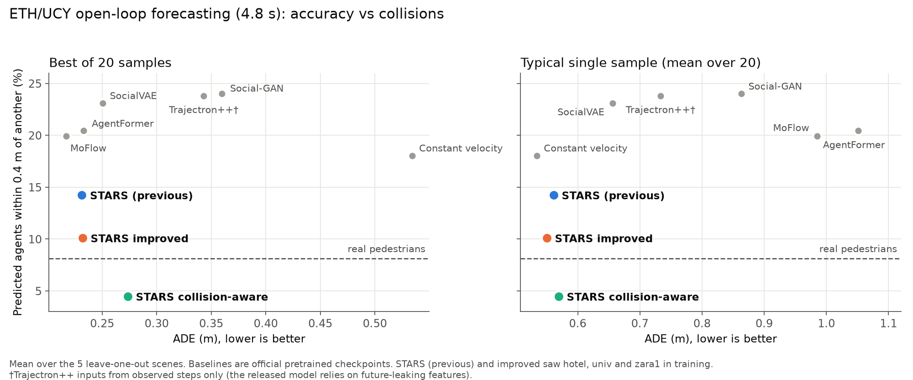
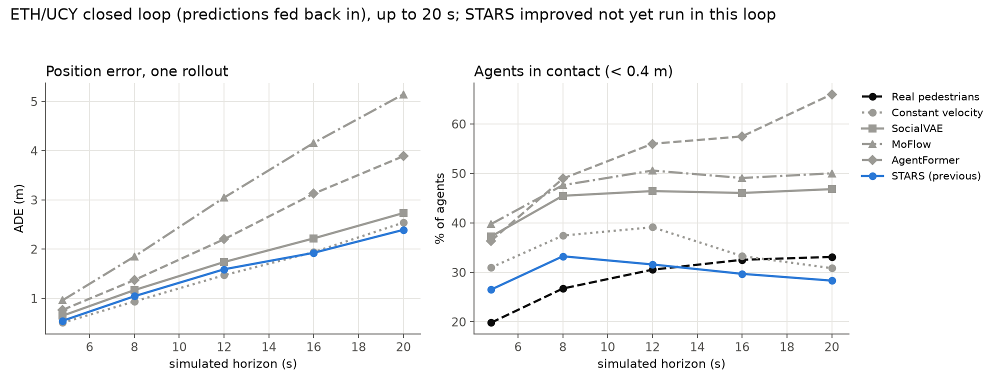

# Forecasting benchmark (2026-11-16)

Open-loop trajectory forecasting (observe 3.2 s, predict 4.8 s, dt 0.4 s) on the standard ETH/UCY
leave-one-out protocol and on each of our datasets' test splits, plus a closed loop up to 20 s.
Full report, tables and commands: [`results/forecasting_2026-11-16_89f5e72/report.md`](../../../results/forecasting_2026-11-16_89f5e72/report.md).
Figures: `python results/forecasting_2026-11-16_89f5e72/figures/make_summary.py`.

| ETH/UCY (mean of 5 scenes) | Best of 20 ADE / FDE (m) | Single sample ADE (m) | Agents within 0.4 m of another |
| --- | --- | --- | --- |
| Real pedestrians | | | 8.1% |
| Constant velocity | 0.53 / 1.15 | 0.53 | 18.0% |
| Social-GAN | 0.36 / 0.64 | 0.86 | 24.0% |
| Trajectron++ (observed-step inputs) | 0.34 / 0.61 | 0.73 | 23.8% |
| SocialVAE | 0.25 / 0.44 | 0.66 | 23.1% |
| AgentFormer | 0.23 / 0.39 | > 1 | 20.4% |
| MoFlow | **0.22 / 0.34** | 0.99 | 19.9% |
| STARS, no ETH/UCY in training (zero-shot) | 0.25 / 0.47 | 0.56 | 14.0% |
| STARS (previous, 6 datasets)* | 0.23 / 0.43 | 0.56 | 14.2% |
| **STARS improved** (7 datasets, 4x oversampling)* | 0.23 / 0.43 | **0.55** | 10.1% |
| **STARS collision-aware*** | 0.27 / 0.51 | 0.57 | **4.5%** |

\* trained on hotel, univ and zara1 (those scenes are leaked; eth and zara2 are clean).
Baselines are the official pretrained checkpoints, reproduced against their papers. Trajectron++'s
published numbers rely on velocity features computed from future positions; with observed steps
only it scores about twice as badly.

In the closed loop (each model's predictions fed back in), STARS has the lowest error of the learned
models at every horizon and keeps contacts near the real rate; the baselines drift to 46-72% of
agents in contact at 20 s. How STARS was improved: branch `stars-improve`,
`results/stars_improve_2026-11-15/README.md`.
