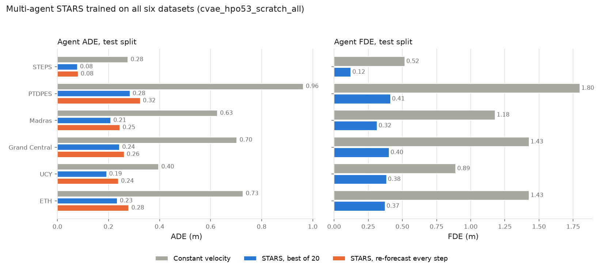

# Multi-agent STARS on all six datasets: test split

Two models, both trained on the mixture in `configs/stars_ma/all.yaml` and evaluated on
each dataset's test split (44928 windows in all). CVAE scores are best-of-20, in metres.

- **Scratch**: `cvae_hpo53_scratch_all`, trained from scratch with the settings of Optuna trial 53.
- **SSL + fine-tune**: `cvae_sslall_finetune_all`, self-supervised pretraining on all datasets, then fine-tuning.
- **Rollout**: the scratch model re-forecasting from its own predictions every 1 or 4 model steps
  (0.4 s or 1.6 s). The STARS crowd in SEAN-JAX re-forecasts every model step, so exec 1 is the
  setting that matters for simulation.

(`python -m baselines.plot_stars_ma_summary --report <eval_test_all.json> --output <png>`)

| Dataset | Constant velocity ADE / FDE | Scratch ADE / FDE | SSL + fine-tune ADE / FDE | Moving ADE, CV / scratch | Rollout ADE, exec 1 / exec 4 |
| --- | --- | --- | --- | --- | --- |
| steps | 0.276 / 0.518 | **0.078 / 0.123** | 0.080 / 0.127 | 0.894 / 0.332 | 0.081 / 0.079 |
| ptdpes | 0.963 / 1.800 | **0.284 / 0.413** | 0.291 / 0.428 | 1.325 / 0.405 | 0.325 / 0.302 |
| madras | 0.627 / 1.180 | **0.209 / 0.315** | 0.217 / 0.328 | 0.683 / 0.231 | 0.245 / 0.219 |
| grand_central | 0.703 / 1.427 | **0.244 / 0.403** | 0.248 / 0.411 | 0.704 / 0.244 | 0.261 / 0.245 |
| ucy | 0.397 / 0.891 | **0.193 / 0.383** | 0.203 / 0.406 | 0.636 / 0.304 | 0.239 / 0.194 |
| eth | 0.727 / 1.428 | **0.234 / 0.373** | 0.237 / 0.378 | 0.744 / 0.239 | 0.280 / 0.236 |

Sources: `experiments/stars_ma/runs/cvae_hpo53_scratch_all/eval_test_all.json` (job 65718) and
`experiments/stars_ma/runs/cvae_sslall_finetune_all/eval_test_{rest,gc}.json` (job 65741, rollout at
exec 4 only). See decision 59.

The full evaluation of the SSL + fine-tune model (`eval_test_all.json`, job 65718) agrees with the
split one to within 0.002 m. Its rollout ADE at exec 1 is 0.086 (STEPS), 0.327 (PTDPES),
0.251 (Madras), 0.281 (Grand Central), 0.253 (UCY) and 0.279 (ETH), as large as or larger than the
scratch model's.
