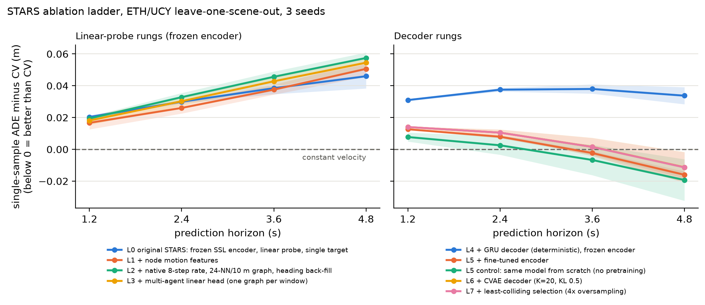

# STARS ablation ladder on ETH/UCY (leave-one-scene-out), 2026-11-18

Branch `stars-ablation` (from `ethucy-protocol`). Starts from the original STARS protocol and adds one design
change per rung, on the standard ETH/UCY benchmark, 3 weight-initialisation seeds per rung.



## Protocol (as agreed)

* **Benchmark.** ETH/UCY leave-one-scene-out with the standard Social-GAN/SocialVAE files: for each held-out scene
  (eth, hotel, univ, zara1, zara2) the head/decoder trains on the fold's `train` files (the other four scenes), is
  selected on the fold's `val` files, and is tested on the held-out scene's `test` file. 8 observed / 12 predicted
  steps at 0.4 s. Scored agents: present in all 20 frames (364 / 1197 / 24334 / 2356 / 5910). The held-out scene is
  never used for training or selection.
* **Self-supervised pretraining data.** STEPS, PTDPES, Grand Central, Madras train splits (validation: their val
  splits). No ATC, no ETH/UCY. One pretrained encoder per seed, shared by all folds; pretraining seed s pairs with
  head/decoder seed s (s = 1, 2, 3).
* **Metrics** at 1.2 / 2.4 / 3.6 / 4.8 s, per-agent micro averages over scored agents per scene, 5-scene mean,
  then mean ± std over the 3 seeds:
  1. *Primary*: single-sample ADE/FDE = error of one random sample, averaged over K = 20 draws (what a simulator
     uses). Equal to the plain error for deterministic models.
  2. Most-likely ADE/FDE (CVAE: prior-mean latent; deterministic models: the prediction).
  3. KDE NLL (Trajectron++/AgentFormer: Gaussian KDE with Scott's bandwidth on the 20 samples per agent and step,
     log-density clipped at -20, averaged over the steps up to the horizon). n/a for deterministic models.
  4. Collision rate at 0.2 m: share of (agent, sample) pairs that come within 0.2 m of another scored agent of
     the same window in the same sample at some step up to the horizon (windows with >= 2 scored agents). The
     ground-truth rate is 0.005 at 4.8 s.
  5. minADE20/minFDE20 only in the published-methods table.
* Code: `src/forecast_bench/ablation_report.py` (metrics, KDE NLL checked against `scipy.stats.gaussian_kde`),
  `src/forecast_bench/stars_ablation.py` (L0–L3), `src/forecast_bench/finetune_stars_loo.py --encoder` (L4–L6).
  The constant-velocity row reproduces the protocol-A tables (0.534 / 1.148, collisions 0.069).

## The ladder

| rung | change (one per rung) | encoder | head / decoder |
|---|---|---|---|
| L0 | original STARS | `HGNNCombinedVAE` (pinned upstream, edge-only), STARS VAE objective; one graph per (window, target), target in STARS's robot slot, fully connected, 8-channel SE(2) edge features resampled to STARS's 40-step grid, STARS heading rule; frozen | STARS linear probe on `[z_target ‖ mean z_others ‖ target history]`, all 12 steps, single target (applied to every scored agent in turn) |
| L1 | + node motion features | + per-node temporal branch on 7 local-frame features per step (position, velocity, speed, cos/sin heading change) | same |
| L2 | + native 8-step rate, 24-NN/10 m graph, heading back-fill | no resampling; each node keeps its 24 nearest sources within 10 m; headings before an agent's first move take that move's direction | same |
| L3 | + multi-agent head | one graph per window, no robot slot (encoder re-pretrained on per-window graphs); every node encoded once | same linear probe, trained on every node (masked over valid future steps) |
| L4 | + GRU decoder | L3's encoder, frozen | deterministic `TrajectoryDecoder` (social round + GRU), LR tuned |
| L5 | + fine-tuned encoder | fine-tuned (encoder-LR multiplier tuned) | same; **control**: identical model from scratch |
| L6 | + CVAE (K = 20) | fine-tuned | CVAE decoder, KL weight tuned |
| L7 | + least-colliding selection | same checkpoints as L6 | draw 4×20 joint samples, keep the 20 with fewest non-group close pairs per scene (inference only) |

The L0 encoder is the unmodified upstream module and loss: `tests/test_stars_ablation.py` checks that our batched
per-target graphs equal the original STARS adapter (`baselines/stars_data.py`: edges, 40-step features, validity,
node types) and that the encoder output equals the pinned `HGNNCombinedVAE` encoder with the same weights.

## Results (5-scene mean at 4.8 s, mean ± std over 3 seeds)

| rung | seeds | single-sample ADE | single-sample FDE | most-likely ADE | most-likely FDE | KDE NLL | collision@0.2 m |
|---|---|---|---|---|---|---|---|
| L0 original STARS: frozen SSL encoder, linear probe, single target | 3 | 0.580 ± 0.008 | 1.219 ± 0.022 | 0.580 ± 0.008 | 1.219 ± 0.022 | n/a | 0.085 ± 0.000 |
| L1 + node motion features | 3 | 0.585 ± 0.005 | 1.248 ± 0.018 | 0.585 ± 0.005 | 1.248 ± 0.018 | n/a | 0.074 ± 0.005 |
| L2 + native 8-step rate, 24-NN/10 m graph, heading back-fill | 3 | 0.591 ± 0.003 | 1.245 ± 0.003 | 0.591 ± 0.003 | 1.245 ± 0.003 | n/a | 0.078 ± 0.004 |
| L3 + multi-agent linear head (one graph per window) | 3 | 0.589 ± 0.004 | 1.241 ± 0.003 | 0.589 ± 0.004 | 1.241 ± 0.003 | n/a | 0.079 ± 0.001 |
| L4 + GRU decoder (deterministic), frozen encoder | 3 | 0.568 ± 0.005 | 1.160 ± 0.015 | 0.568 ± 0.005 | 1.160 ± 0.015 | n/a | 0.076 ± 0.002 |
| L5 + fine-tuned encoder | 3 | 0.518 ± 0.002 | 1.077 ± 0.009 | 0.518 ± 0.002 | 1.077 ± 0.009 | n/a | 0.056 ± 0.002 |
| L5 control: same model from scratch (no pretraining) | 3 | 0.515 ± 0.013 | 1.078 ± 0.026 | 0.515 ± 0.013 | 1.078 ± 0.026 | n/a | 0.063 ± 0.001 |
| L6 + CVAE decoder (K=20) | 3 | 0.529 ± 0.006 | 1.104 ± 0.018 | 0.550 ± 0.002 | 1.142 ± 0.007 | 11.597 ± 1.245 | 0.057 ± 0.002 |
| L7 + least-colliding selection (4x oversampling) | 3 | 0.529 ± 0.007 | 1.104 ± 0.018 | 0.550 ± 0.002 | 1.142 ± 0.007 | 11.614 ± 1.247 | 0.054 ± 0.001 |
| sensitivity: L0 with 15-epoch SSL | 3 | 0.587 ± 0.008 | 1.229 ± 0.015 | 0.587 ± 0.008 | 1.229 ± 0.015 | n/a | 0.082 ± 0.001 |
| sensitivity: L1 with 15-epoch SSL | 3 | 0.587 ± 0.002 | 1.247 ± 0.007 | 0.587 ± 0.002 | 1.247 ± 0.007 | n/a | 0.075 ± 0.000 |
| sensitivity: L2 with 15-epoch SSL | 3 | 0.591 ± 0.007 | 1.241 ± 0.015 | 0.591 ± 0.007 | 1.241 ± 0.015 | n/a | 0.081 ± 0.001 |
| sensitivity: L3 with 15-epoch SSL | 3 | 0.594 ± 0.003 | 1.260 ± 0.006 | 0.594 ± 0.003 | 1.260 ± 0.006 | n/a | 0.082 ± 0.003 |
| cv | 1 | 0.534 | 1.148 | 0.534 | 1.148 | n/a | 0.069 |

Ground-truth collision rate at 0.2 m (4.8 s): 0.0050.

### Per horizon (single-sample ADE / FDE, m)

| rung | 1.2 s | 2.4 s | 3.6 s | 4.8 s |
|---|---|---|---|---|
| L0 original STARS: frozen SSL encoder, linear probe, single target | 0.131 / 0.205 | 0.260 / 0.487 | 0.411 / 0.831 | 0.580 / 1.219 |
| L1 + node motion features | 0.127 / 0.199 | 0.256 / 0.486 | 0.410 / 0.841 | 0.585 / 1.248 |
| L2 + native 8-step rate, 24-NN/10 m graph, heading back-fill | 0.130 / 0.205 | 0.263 / 0.498 | 0.418 / 0.850 | 0.591 / 1.245 |
| L3 + multi-agent linear head (one graph per window) | 0.129 / 0.204 | 0.260 / 0.493 | 0.415 / 0.847 | 0.589 / 1.241 |
| L4 + GRU decoder (deterministic), frozen encoder | 0.142 / 0.216 | 0.268 / 0.487 | 0.410 / 0.805 | 0.568 / 1.160 |
| L5 + fine-tuned encoder | 0.123 / 0.190 | 0.238 / 0.439 | 0.370 / 0.738 | 0.518 / 1.077 |
| L5 control: same model from scratch (no pretraining) | 0.119 / 0.184 | 0.233 / 0.434 | 0.366 / 0.736 | 0.515 / 1.078 |
| L6 + CVAE decoder (K=20) | 0.123 / 0.190 | 0.240 / 0.447 | 0.376 / 0.757 | 0.529 / 1.104 |
| L7 + least-colliding selection (4x oversampling) | 0.123 / 0.190 | 0.240 / 0.446 | 0.376 / 0.756 | 0.529 / 1.104 |
| sensitivity: L0 with 15-epoch SSL | 0.135 / 0.210 | 0.265 / 0.494 | 0.417 / 0.840 | 0.587 / 1.229 |
| sensitivity: L1 with 15-epoch SSL | 0.129 / 0.201 | 0.258 / 0.489 | 0.412 / 0.843 | 0.587 / 1.247 |
| sensitivity: L2 with 15-epoch SSL | 0.132 / 0.207 | 0.264 / 0.498 | 0.419 / 0.849 | 0.591 / 1.241 |
| sensitivity: L3 with 15-epoch SSL | 0.129 / 0.204 | 0.262 / 0.496 | 0.418 / 0.856 | 0.594 / 1.260 |
| cv | 0.111 / 0.178 | 0.230 / 0.442 | 0.372 / 0.770 | 0.534 / 1.148 |

### Per held-out scene (single-sample ADE / FDE at 4.8 s, mean ± seed std)

| rung | eth | hotel | univ | zara1 | zara2 |
|---|---|---|---|---|---|
| L0 original STARS: frozen SSL encoder, linear probe, single target | 1.04 ± 0.01 / 2.07 ± 0.02 | 0.43 ± 0.01 / 0.88 ± 0.03 | 0.55 ± 0.00 / 1.18 ± 0.01 | 0.47 ± 0.02 / 1.03 ± 0.06 | 0.42 ± 0.00 / 0.95 ± 0.01 |
| L1 + node motion features | 1.05 ± 0.02 / 2.16 ± 0.06 | 0.47 ± 0.02 / 0.98 ± 0.04 | 0.56 ± 0.00 / 1.21 ± 0.01 | 0.44 ± 0.00 / 0.98 ± 0.01 | 0.40 ± 0.01 / 0.90 ± 0.01 |
| L2 + native 8-step rate, 24-NN/10 m graph, heading back-fill | 1.03 ± 0.01 / 2.11 ± 0.04 | 0.48 ± 0.02 / 0.94 ± 0.04 | 0.57 ± 0.01 / 1.23 ± 0.02 | 0.45 ± 0.00 / 0.98 ± 0.00 | 0.43 ± 0.00 / 0.96 ± 0.01 |
| L3 + multi-agent linear head (one graph per window) | 1.05 ± 0.01 / 2.11 ± 0.03 | 0.46 ± 0.01 / 0.91 ± 0.00 | 0.56 ± 0.00 / 1.25 ± 0.01 | 0.45 ± 0.01 / 0.97 ± 0.01 | 0.43 ± 0.01 / 0.97 ± 0.01 |
| L4 + GRU decoder (deterministic), frozen encoder | 1.00 ± 0.02 / 2.01 ± 0.06 | 0.40 ± 0.01 / 0.75 ± 0.01 | 0.61 ± 0.02 / 1.28 ± 0.04 | 0.44 ± 0.01 / 0.94 ± 0.02 | 0.39 ± 0.01 / 0.83 ± 0.02 |
| L5 + fine-tuned encoder | 0.95 ± 0.01 / 1.91 ± 0.03 | 0.33 ± 0.01 / 0.63 ± 0.04 | 0.56 ± 0.02 / 1.21 ± 0.05 | 0.41 ± 0.00 / 0.90 ± 0.01 | 0.33 ± 0.01 / 0.73 ± 0.02 |
| L5 control: same model from scratch (no pretraining) | 0.99 ± 0.03 / 2.03 ± 0.09 | 0.31 ± 0.01 / 0.60 ± 0.01 | 0.52 ± 0.01 / 1.12 ± 0.00 | 0.42 ± 0.04 / 0.91 ± 0.07 | 0.34 ± 0.06 / 0.73 ± 0.11 |
| L6 + CVAE decoder (K=20) | 0.99 ± 0.03 / 1.99 ± 0.07 | 0.30 ± 0.01 / 0.57 ± 0.02 | 0.58 ± 0.01 / 1.25 ± 0.02 | 0.44 ± 0.00 / 0.96 ± 0.01 | 0.34 ± 0.01 / 0.76 ± 0.02 |
| L7 + least-colliding selection (4x oversampling) | 0.99 ± 0.03 / 1.99 ± 0.07 | 0.30 ± 0.01 / 0.57 ± 0.01 | 0.58 ± 0.01 / 1.25 ± 0.02 | 0.44 ± 0.00 / 0.96 ± 0.01 | 0.34 ± 0.01 / 0.75 ± 0.02 |
| sensitivity: L0 with 15-epoch SSL | 1.04 ± 0.01 / 2.08 ± 0.03 | 0.44 ± 0.01 / 0.90 ± 0.04 | 0.55 ± 0.01 / 1.18 ± 0.01 | 0.48 ± 0.02 / 1.04 ± 0.06 | 0.43 ± 0.01 / 0.95 ± 0.01 |
| sensitivity: L1 with 15-epoch SSL | 1.06 ± 0.01 / 2.18 ± 0.04 | 0.46 ± 0.01 / 0.94 ± 0.01 | 0.55 ± 0.01 / 1.19 ± 0.01 | 0.45 ± 0.01 / 1.01 ± 0.01 | 0.41 ± 0.00 / 0.92 ± 0.02 |
| sensitivity: L2 with 15-epoch SSL | 1.03 ± 0.02 / 2.09 ± 0.05 | 0.46 ± 0.01 / 0.90 ± 0.03 | 0.58 ± 0.00 / 1.25 ± 0.02 | 0.45 ± 0.00 / 1.00 ± 0.01 | 0.43 ± 0.01 / 0.96 ± 0.02 |
| sensitivity: L3 with 15-epoch SSL | 1.05 ± 0.00 / 2.15 ± 0.01 | 0.47 ± 0.01 / 0.95 ± 0.02 | 0.57 ± 0.01 / 1.23 ± 0.01 | 0.45 ± 0.00 / 1.00 ± 0.01 | 0.43 ± 0.01 / 0.97 ± 0.02 |
| cv | 1.08 / 2.28 | 0.32 / 0.61 | 0.52 / 1.17 | 0.43 / 0.95 | 0.32 / 0.72 |

### Comparison with published methods (minADE20 / minFDE20 at 4.8 s; not our evaluation metric)

| method | eth | hotel | univ | zara1 | zara2 | avg | single-sample ADE / FDE avg |
|---|---|---|---|---|---|---|---|
| cv | 1.08 / 2.28 | 0.32 / 0.61 | 0.52 / 1.17 | 0.43 / 0.95 | 0.32 / 0.72 | 0.53 / 1.15 | 0.53 / 1.15 |
| sgan_official | 0.61 / 1.01 | 0.33 / 0.65 | 0.40 / 0.72 | 0.23 / 0.43 | 0.22 / 0.39 | 0.36 / 0.64 | 0.86 / 1.79 |
| trajectron_official | 0.77 / 1.34 | 0.24 / 0.36 | 0.30 / 0.58 | 0.23 / 0.43 | 0.17 / 0.33 | 0.34 / 0.61 | 0.73 / 1.58 |
| agentformer_official | 0.45 / 0.75 | 0.14 / 0.22 | 0.25 / 0.45 | 0.18 / 0.30 | 0.14 / 0.24 | 0.23 / 0.39 | 1.05 / 2.34 |
| socialvae_official | 0.50 / 0.86 | 0.15 / 0.22 | 0.25 / 0.48 | 0.20 / 0.36 | 0.15 / 0.29 | 0.25 / 0.44 | 0.66 / 1.42 |
| moflow_official | 0.42 / 0.61 | 0.11 / 0.17 | 0.25 / 0.41 | 0.17 / 0.29 | 0.12 / 0.22 | 0.22 / 0.34 | 0.99 / 2.09 |
| L0 original STARS: frozen SSL encoder, linear probe, single target | 1.04 / 2.07 | 0.43 / 0.88 | 0.55 / 1.18 | 0.47 / 1.03 | 0.42 / 0.95 | 0.58 / 1.22 | 0.58 / 1.22 |
| L1 + node motion features | 1.05 / 2.16 | 0.47 / 0.98 | 0.56 / 1.21 | 0.44 / 0.98 | 0.40 / 0.90 | 0.58 / 1.25 | 0.58 / 1.25 |
| L2 + native 8-step rate, 24-NN/10 m graph, heading back-fill | 1.03 / 2.11 | 0.48 / 0.94 | 0.57 / 1.23 | 0.45 / 0.98 | 0.43 / 0.96 | 0.59 / 1.25 | 0.59 / 1.25 |
| L3 + multi-agent linear head (one graph per window) | 1.05 / 2.11 | 0.46 / 0.91 | 0.56 / 1.25 | 0.45 / 0.97 | 0.43 / 0.97 | 0.59 / 1.24 | 0.59 / 1.24 |
| L4 + GRU decoder (deterministic), frozen encoder | 1.00 / 2.01 | 0.40 / 0.75 | 0.61 / 1.28 | 0.44 / 0.94 | 0.39 / 0.83 | 0.57 / 1.16 | 0.57 / 1.16 |
| L5 + fine-tuned encoder | 0.95 / 1.91 | 0.33 / 0.63 | 0.56 / 1.21 | 0.41 / 0.90 | 0.33 / 0.73 | 0.52 / 1.08 | 0.52 / 1.08 |
| L5 control: same model from scratch (no pretraining) | 0.99 / 2.03 | 0.31 / 0.60 | 0.52 / 1.12 | 0.42 / 0.91 | 0.34 / 0.73 | 0.51 / 1.08 | 0.51 / 1.08 |
| L6 + CVAE decoder (K=20) | 0.85 / 1.68 | 0.23 / 0.42 | 0.49 / 1.07 | 0.35 / 0.75 | 0.25 / 0.55 | 0.44 / 0.89 | 0.53 / 1.10 |
| L7 + least-colliding selection (4x oversampling) | 0.85 / 1.68 | 0.23 / 0.42 | 0.49 / 1.07 | 0.35 / 0.75 | 0.25 / 0.56 | 0.44 / 0.89 | 0.53 / 1.10 |
| sensitivity: L0 with 15-epoch SSL | 1.04 / 2.08 | 0.44 / 0.90 | 0.55 / 1.18 | 0.48 / 1.04 | 0.43 / 0.95 | 0.59 / 1.23 | 0.59 / 1.23 |
| sensitivity: L1 with 15-epoch SSL | 1.06 / 2.18 | 0.46 / 0.94 | 0.55 / 1.19 | 0.45 / 1.01 | 0.41 / 0.92 | 0.59 / 1.25 | 0.59 / 1.25 |
| sensitivity: L2 with 15-epoch SSL | 1.03 / 2.09 | 0.46 / 0.90 | 0.58 / 1.25 | 0.45 / 1.00 | 0.43 / 0.96 | 0.59 / 1.24 | 0.59 / 1.24 |
| sensitivity: L3 with 15-epoch SSL | 1.05 / 2.15 | 0.47 / 0.95 | 0.57 / 1.23 | 0.45 / 1.00 | 0.43 / 0.97 | 0.59 / 1.26 | 0.59 / 1.26 |

## What each rung changed, and whether it helped

Differences are called real only when they exceed the seed standard deviations of both rungs; otherwise "no
measurable difference".

* **L0 original STARS (0.580 ± 0.008 / 1.219 ± 0.022).** The frozen STARS representation with STARS's linear probe
  is worse than constant velocity at every horizon (CV 0.534 / 1.148; +0.020 m at 1.2 s, +0.046 m at 4.8 s).
* **L1 node motion features:** no measurable difference in ADE/FDE (0.585 ± 0.005); fewer predicted collisions
  (0.074 ± 0.005 vs 0.085 ± 0.000).
* **L2 native rate, 24-NN graph, heading fix:** no measurable difference (0.591 ± 0.003). Justified by cost, not
  accuracy: no resampling and kNN edges make SSL ~1.6× cheaper per epoch and remove the 18-node cap.
* **L3 multi-agent head:** no measurable difference (0.589 ± 0.004); one encoder pass per scene instead of one per
  agent, which is what the later decoder rungs need.
* **L4 GRU decoder (frozen encoder):** better at long horizons (4.8 s: 0.568 ± 0.005 / 1.160 ± 0.015 vs
  0.589 / 1.241), worse at 1.2 s (0.142 vs 0.129). Still worse than CV at every horizon.
* **L5 fine-tuning the encoder:** the largest gain on the ladder (0.518 ± 0.002 / 1.077 ± 0.009; collisions
  0.056 ± 0.002 vs 0.076). First rung better than CV at 3.6 and 4.8 s.
  **Pretraining control:** the same model from scratch reaches the same accuracy (0.515 ± 0.013 / 1.078 ± 0.026):
  no measurable accuracy benefit of self-supervised pretraining on this benchmark. Pretraining does give fewer
  predicted collisions (0.056 ± 0.002 vs 0.063 ± 0.001) and lower seed variance (ADE std 0.002 vs 0.013).
* **L6 CVAE (K = 20):** worse single-sample accuracy than the deterministic L5 (0.529 ± 0.006 vs 0.518 ± 0.002; FDE
  1.104 vs 1.077) and worse most-likely accuracy (0.550 ± 0.002), no measurable change in collisions
  (0.057 ± 0.002). It does produce a distribution (minADE20 0.44 vs 0.52), but a poorly calibrated, too narrow one:
  KDE NLL 11.6 ± 1.2 against 1.05–3.3 for the published generative baselines. The KL weight chosen (0.15) is the
  largest of the first sweep, see the KL note below.
* **L7 least-colliding selection:** fewer predicted collisions (0.054 ± 0.001 vs 0.057 ± 0.002, within ~1 std
  of each other, so at best a small effect) at no accuracy cost (0.529 / 1.104, unchanged).
* **SSL length (15 vs 40 epochs):** no measurable difference for any probe rung (e.g. L0 0.587 ± 0.008 vs
  0.580 ± 0.008), although the E0 reconstruction loss fell 13× in the continuation: better STARS reconstruction
  does not translate into better linear-probe forecasts.

**Overall.** On ETH/UCY LOSO with a simulation-relevant metric, the STARS-specific design choices (L1–L3) have no
measurable effect on accuracy; what matters is a trained decoder and training the encoder end to end (L4, L5),
and self-supervised pretraining gives no accuracy gain over training from scratch (only fewer collisions and
lower seed variance). The best rung by the primary metric (L5, 0.518 / 1.077) beats CV by 0.016 m ADE / 0.071 m
FDE at 4.8 s and is behind CV at 1.2 s (0.123 vs 0.111).

## Deviations from the original STARS protocol (and other choices)

* **SSL schedule capped.** STARS trains the VAE for up to 1000 epochs with patience 20 and a 50-epoch β warm-up.
  Here every encoder (E0–E3) trains 15 epochs (β warm-up 3 epochs, cosine LR) and then 25 more epochs from that
  checkpoint with a new cosine schedule and β fixed at 0.9 (40 epochs in total, a warm restart); the best epoch is
  chosen by validation loss at β = 0.9. At the end of the 25-epoch continuation validation loss changed by ≤ 3% over
  the last 3 epochs (0.0–3.0%; at 15 epochs it was still falling 6.4% for E0). The 15-epoch encoders are kept as the
  "sensitivity" rows: they do not change any conclusion (L0 0.587 ± 0.008 vs 0.580 ± 0.008 with 40 epochs).
* **Graph size capped at 18 nodes for L0/L1** (the target and its 17 nearest pedestrians at the last observed step,
  fully connected among them). STARS's own graphs have at most 18 nodes; uncapped fully connected 40-step
  per-target graphs on our pretraining data would cost ~10^12 edge-steps per epoch.
* **Batch and learning rate.** 4096 nodes per step for every encoder (≈ 7 STARS batches of 32 18-node graphs);
  STARS's LR 1.16e-4 scaled by sqrt(4096/600) to 3.0e-4. AdamW, weight decay 1e-4, gradient clip 1 as STARS.
* **SSL training graphs:** one target per window, drawn with a fixed seed (each pedestrian is still a target in many
  overlapping windows).
* **Nodes** are pedestrians visible at the last observed step with ≥ 2 observed points (our window files' rule;
  STARS's adapter does not require visibility at the last step).
* **Probe frame:** history and future in each agent's own frame (origin at its last observed position, x along its
  last heading), the same for every rung (STARS used the dataset's target-centred frame).
* **Probe recipe** is STARS's (`train_swm_forecasting_linear_probe_v1.py`): AdamW 1e-3, weight decay 1e-4, batch 8,
  ≤ 80 epochs, LR on plateau (patience 8), early stopping on validation ADE (patience 14).
* **Decoder recipe (L4–L7)** = `stars_improved`: decoder hidden 512, dropout 0.0633, CVAE latent 64, AdamW, weight
  decay 0.00217, 2 warm-up epochs then cosine to 0 over ≤ 100 epochs, early stopping after 20 epochs without a
  validation gain, best epoch by validation single-sample ADE (mean over 20 draws). Tuned on seed-1 validation only
  (mean over the 5 folds' val splits), then used for seeds 1–3:
  * L4 learning rate: 3e-4 → 0.498, **1e-3 → 0.472** (chosen).
  * L5 encoder-LR multiplier: 0.1 → 0.454, **1.0 → 0.427** (chosen; the larger value tested, i.e. at the sweep
    boundary; the encoder then trains at the decoder's LR).
  * L6 KL weight: 0.03 → 0.521, 0.08 → 0.467, **0.15 → 0.447** (chosen; the largest value tested, at the sweep boundary). An extension to 0.3 and 0.5 on seed-1 validation was queued at the time of writing; see the final report for whether it changes the choice.
* Two seed-2 15-epoch encoder requests (E1, E2) report exit code 127: the training finished and saved (status
  complete, 15/15 epochs); the code came from the queue wrapper script being edited after training, not from training.

## Commands

```bash
# self-supervised encoders (E0..E3 = L0, L1, L2, L3+) and their 25-epoch continuation
bash runs/stars_ablation/ssl.sh E0 1            # flags in runs/stars_ablation/ssl_flags.sh
bash runs/stars_ablation/ssl_long.sh E0 1
# L0-L3 linear probes (all 5 folds)
bash runs/stars_ablation/probe.sh 1 _long long L0 L1 L2 L3
# L4-L6 (5 folds in parallel, then K=20 and prior-mean predictions); configuration choice on seed-1 validation
bash runs/stars_ablation/loso.sh L4_lr1e-3 1 E3 --decoder deterministic --encoder-mode frozen --lr 1e-3
python runs/stars_ablation/select_config.py L4 'lr3e-4=--lr 3e-4' 'lr1e-3=--lr 1e-3'
# L7: least-colliding selection on the L6 checkpoints
python -m forecast_bench.predict --method abl_L6_s1_os4 --sets ethucy_eth,ethucy_hotel,ethucy_univ,ethucy_zara1,ethucy_zara2
# tables and figure
python -m forecast_bench.ablation_report --rungs runs/stars_ablation/rungs_final.json --out results/stars_ablation_2026-11-18
```

All requests ran unattended through `runs/stars_ablation/{node.slurm,worker.sh,keeper.sh}` (30-minute 4-GPU
nodes, resumable trainers, `# needs:` dependencies); the exact request files are in `runs/stars_ablation/queue`
(not committed). Compute: about 39 GPU-hours in total.

Files: `summary.csv` (every metric and horizon, mean and std over seeds), `per_fold_seed.csv` (every rung × seed ×
scene), `tables.md` (the tables above), `ladder_ade_vs_horizon.png`, `selection/*.json` (the validation sweeps).
